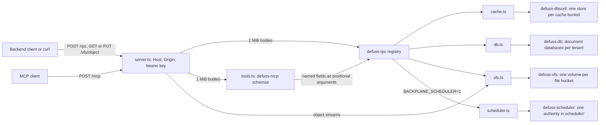

# Architecture

The daemon binds a single IPv4 socket to 127.0.0.1. Node.js and Bun run the same ESM build and use the same disk layout. A local application owns its public HTTP API and its end-user access decisions.

| Boundary | Responsibility |
| --- | --- |
| Server | Validates Host, Origin and the bot credential before dispatch, including schema and tool discovery. Caps `/rpc` and `/mcp` request bodies at 1 MiB. `/vfs/object` streams file bytes in either direction without that cap. |
| RPC | defuss-rpc registers the cache, database and file functions, and the scheduler functions when scheduling is on, and returns DSON results. The backend client authenticates its own discovery fetch because defuss-rpc 3.0.0 omits custom headers on that request. |
| MCP | defuss-mcp publishes named JSON schemas and validates the arguments. The adapter maps named fields into the RPC call order and passes each call to the same in-process dispatcher. A document can have arbitrary fields, so the adapter uses the registry's JSON schema API. |
| Engines | defuss-dbsonl 0.9.0 stores cache entries. defuss-db 3.1.0 stores documents in named collections. defuss-vfs 0.3.0 stores files in one volume per bucket. Each of these service modules owns one handle pool. defuss-scheduler 0.1.0 stores schedules and runs for every scope in one authority, in its own defuss-db database with a version history of each. |

## Request flow

Every request passes the server's checks before either protocol parses it, and both protocols end in the same service functions. Each node names the module or package that owns the step.

`faults.ts` wraps each dispatch so that a service fault keeps its code and status in both protocols. `scope.ts` validates and encodes the scope, key and ID before `cache.ts`, `db.ts` or `vfs.ts` leases a handle from its own `pool.ts` pool. `storage.ts` holds the filesystem checks that the pools use, and `services.ts` composes the three services for the daemon and the tests. Splitting by engine keeps each revision protocol next to the store whose transaction it relies on. The pure validation stays separate from the filesystem.

The file endpoint streams a request body into one defuss-vfs `putStream` call, and a download pipes one `getStream` snapshot into the response. defuss-rpc 3.0.0 also offers upload and download routes, which this daemon keeps closed. VERIFIED from its source: an upload spools the whole body to a temporary file before the handler runs, keeps a session under an upload ID the client chooses, and reports a handler failure inside an HTTP 200 response. Its stock client also sends the resume probe without custom headers, so the bearer check would reject it. The direct stream writes each byte once, holds no session state and returns faults with their HTTP status in the `/rpc` error body.

The release bundles code from the pinned defuss-db package and its search libraries. The database opens through its public `openDatabase` API with a native file backend. This keeps its storage format and leaves model runtimes out of the consumer installation.

## Storage and concurrency

A logical identifier becomes a lowercase hexadecimal representation of its UTF-8 bytes with an alphabetic prefix. This maps distinct identifiers to distinct filesystem components, even on case-insensitive volumes. The app directory contains its tenant directories. Within each tenant, each cache bucket has a KV store, each file bucket has a defuss-vfs volume directory, and DB buckets are named collections. Short names share one database per tenant. When an encoded name exceeds the engine's 64-character collection limit, its remaining digits select a database subdirectory so long names with a common prefix stay distinct. Identical names in different services select different storage.

Each engine pool holds up to 32 handles. A lease keeps its handle open until the operation finishes. Cold opens serialize within the pool to coalesce concurrent requests for the same store. On reaching capacity, a cold open evicts the least recently used idle handle. If all handles are busy, the caller receives an error and may retry that operation. A download holds its volume lease until its stream ends, fails or is cancelled. VERIFIED by probe: closing a volume fails the reads of an open `getStream` snapshot, so the lease keeps the pool from evicting it. A client that disconnects mid-download cancels the stream and releases the lease. VERIFIED by probe on both runtimes: a client that stays connected but stops reading keeps its lease for at least 75 seconds, so each stalled reader holds one of the 32 handles until it disconnects or the daemon shuts down.

Cache TTL is an absolute expiry on the daemon clock. A read reports an expired entry as a miss. Expired entries stay on disk until overwritten or explicitly deleted. A cold read checks the shard directory under the pool admission queue. Only a confirmed empty or missing directory qualifies as absent. Existing stores open with creation disabled so an I/O failure propagates. Each write uses its engine's commit protocol. Operations across engines commit independently. A streamed upload publishes the object once, after its last chunk, so a failed upload leaves the previous object and revision.

## Scheduling

The scheduler keeps one authority open from startup to shutdown in the `scheduler` directory of the data root. Encoded app directories start with `x`, so no app can claim that name. Every scope is a key prefix inside the authority. The storage services instead open a store per bucket on demand, and their pools close idle stores at capacity. The defuss-scheduler documentation places calendar production and lease expiry in the open authority's maintenance loop, so a pooled authority would stop creating runs whenever the pool closed it. `scheduler.ts` checks each scope with the storage services' rules and then calls the scoped queue, so every service accepts the same app, tenant and bucket names.

Scheduling is opt-in. The authority runs maintenance every 250 ms by default, per its documentation, and holds an exclusive lock on its directory. VERIFIED by test: a second scheduling daemon on the same data root fails with `OWNER_BUSY` before it listens. Scheduler faults map to the shared codes. A call that reaches a closed authority returns `BUSY`, and an unreadable store returns `STORAGE_ERROR`. MCP exposes only the management operations. Workers claim and report over RPC, which carries the lease identity in typed arguments.

## Revisions

A file's revision is the content revision that defuss-vfs stores with the object. A conditional write passes the token as `ifMatch`, and a null token as `ifAbsent`, so the comparison and the publication share one volume transaction.

A cache write stores a random token with the value. A conditional change reads the entry, compares its logical revision including TTL, and stages its mutation inside one DBSONL transaction. A v0.1 cache entry derives its first token from its address and persisted entry revision.

In each database partition the user collection starts with `x` and its companion revision collection starts with `v`. The document and token share a native database transaction. A versioned read uses one snapshot for both collections. A legacy document derives a scoped initial token from its typed primary key and the database identity. Reads need no migration write. Successful inserts and updates assign a fresh token, including updates that restore earlier content. Deletes remove both records. Internal metadata stays out of user documents, projections and application bucket names. Revision guarantees cover writes through this daemon. Older daemons and native writers do not maintain the companion collection.

Each network call owns its fault context. The adapters preserve engine error codes before defuss-rpc or defuss-mcp reduces an exception to a message. Successful calls use the protocol's original response. A schema rejection retains its MCP field corrections.

## Security and operations

The daemon requires a bearer key for every network request. It accepts Host values for 127.0.0.1 or localhost at its configured port and rejects any request carrying Origin. The backend client uses a literal loopback URL and rejects redirects. Local processes sharing a bot key share access to all app shards, including every scope's schedules and runs. The daemon does not mount the defuss-scheduler HTTP worker endpoint. An application that serves remote workers mounts it behind its own authentication. A backend derives tenant selection from its own authenticated request. Containers need a common network namespace to use this listener.

The service creates data directories with owner-only mode on POSIX. Run it under an account that owns its data root and credentials. Cache entries, documents, files, schedule payloads and run results persist on disk unencrypted and may contain personal data supplied by the application. The scheduler keeps every version of a schedule, payloads included. The daemon keeps the default run retention, so the defuss-scheduler documentation places the removal of a finished run, with its history, payload, result and error text, one day after it ends. The application operator controls the other data's retention and backups. The listener has no total request deadline, so long transfers can finish. On shutdown it stops accepting connections and gives active requests 3 seconds, then closes the remaining connections before the engine pools and the scheduler close. VERIFIED by probe and the packed-consumer test: a client that stops reading a large download keeps its connection open, and the daemon still exits 0 on SIGTERM. Closing the connection aborts an unfinished upload, which keeps the previous object.

The packed-consumer test installs the tarball into a temporary application and exercises all fifteen tools, and all twenty-seven with scheduling on. It uses the official MCP client, curl and the typed client. It starts from a fixture written by the v0.1.0 release tarball (SHA-256 fec0fccbbb34e0933578cb9094ddecb994117ccbb4935bf9ff6d1f97928f09d8). Each of six consumer phases upgrades one legacy cache entry and document. Restarts on the same files check revision continuity across runtimes. Concurrent RPC and MCP writes using the same token verify one winning mutation per item. Each phase streams a file larger than 1 MiB through the client and through curl, and the next phase reads the previous phase's file on the other runtime. Two more phases start the daemon with `BACKPLANE_SCHEDULER=1`. A Node.js daemon with a Bun consumer creates and edits a schedule, races sixteen claims for one grant and completes a retried run. A Bun daemon with a Node.js consumer then reads the paused schedule and the run result over RPC and MCP, and resumes, removes and creates schedules.

The consumer scripts are TypeScript files that Node.js type stripping and Bun run without a build step. Before they run, the strict compiler checks them against the packed declarations and rejects syntax that type stripping cannot erase.

In each of the three storage phases, lsof must list `127.0.0.1:<port>` as the daemon's only TCP listener; it lists wildcard IPv4 and IPv6 listeners as `*:<port>`. A connection attempt to 127.0.0.2 cannot make this distinction on the macOS development host: that address is unassigned there, so wildcard and loopback listeners both time out.
