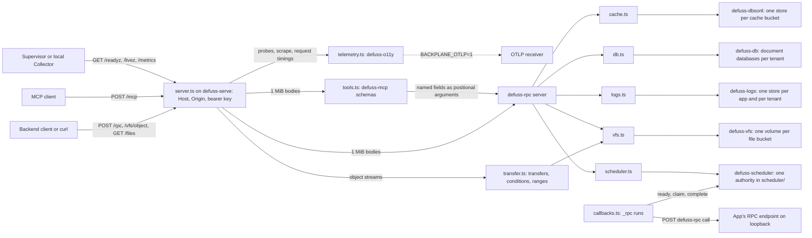

# Architecture

The daemon binds a single IPv4 socket to 127.0.0.1. Node.js and Bun run the same ESM build and use the same disk layout. A local application owns its public HTTP API and its end-user access decisions.

| Boundary | Responsibility |
| --- | --- |
| Server | [defuss-serve](https://github.com/kyr0/defuss-serve) owns the listener. Each route is a plugin that validates Host, Origin and the bot credential before it reads a body, including schema and tool discovery. Only the health probes skip the credential. Caps `/rpc` and `/mcp` request bodies at 1 MiB, and reads an oversized body to its end before the 413 so the sender receives it. Only a caller with the key gets that far, and it could stream any size through `/vfs/object` anyway. `/vfs/object` streams file bytes in either direction without that cap, and `/files` serves reads with byte ranges. |
| RPC | Each daemon creates its own [defuss-rpc](https://github.com/kyr0/defuss-rpc) server for the cache, database, file, log and scheduler functions, and returns DSON results. The server closes with the daemon, so a later daemon in the same process serves only its own functions. Each `defuss-backplane/client` connection is a [defuss-rpc](https://github.com/kyr0/defuss-rpc) client context with the bot key, typed with `BackplaneApi` (`src/api.ts`), the type derived from the services the daemon serves, so the handles and plain defuss-rpc callers are both checked against the server's signatures. A context has its own hooks, headers and schema cache, so the application's `addHook()` and `setHeaders()` never reach backplane calls. VERIFIED by `tests/client.test.ts`: an application guard that blocks every call leaves backplane calls alone. The context's `fetch` makes every request refuse a redirect, the schema request included. VERIFIED by probe on Node.js 26.13.1 and Bun 1.4.3: fetch drops the Authorization header on a 307 to another port but sends the request body there. VERIFIED by `tests/client.test.ts`: without that policy, a redirected call and a redirected schema request reached the other listener. A connection builds its client from the schema it fetched, so it sends one schema request. |
| MCP | [defuss-mcp](https://github.com/kyr0/defuss-mcp) publishes named JSON schemas and validates the arguments. The adapter maps named fields into the RPC call order and passes each call to the same in-process dispatcher. A document can have arbitrary fields, so the adapter uses the registry's JSON schema API. |
| Telemetry | `telemetry.ts` holds one [defuss-o11y](https://github.com/kyr0/defuss-o11y) instance per daemon: the storage readiness check, the gauges, and histograms of service calls and requests. The probes and `/metrics` are two more plugins, and an OTLP push is opt-in. |
| Engines | [defuss-dbsonl](https://github.com/kyr0/defuss-dbsonl) stores cache entries. [defuss-db](https://github.com/kyr0/defuss-db) stores documents in named collections. [defuss-vfs](https://github.com/kyr0/defuss-vfs) stores files in one volume per bucket. [defuss-logs](https://github.com/kyr0/defuss-logs) stores one log per app and one per tenant of an app. Each of these service modules owns one handle pool. [defuss-scheduler](https://github.com/kyr0/defuss-scheduler) stores schedules and runs for every scope in one authority, in its own [defuss-db](https://github.com/kyr0/defuss-db) database with a version history of each. |

## Request flow

Every request passes the server's checks before either protocol parses it, and both protocols end in the same service functions. Each node names the module or package that owns the step.

`faults.ts` wraps each dispatch so that a service fault keeps its code and status in both protocols. `scope.ts` validates and encodes the scope, key and ID before `cache.ts`, `db.ts`, `vfs.ts` or `logs.ts` leases a handle from its own `pool.ts` pool. `storage.ts` holds the filesystem checks that the pools use, and `services.ts` composes the four services for the daemon and the tests. Splitting by engine keeps each revision protocol next to the store whose transaction it relies on. The pure validation stays separate from the filesystem.

The file endpoint streams a request body into one [defuss-vfs](https://github.com/kyr0/defuss-vfs) `putStream` call, and a download pipes one `getStream` snapshot into the response. [defuss-rpc](https://github.com/kyr0/defuss-rpc) also offers upload and download routes, which this daemon keeps closed by passing only `/rpc` and `/rpc/schema` to its RPC server. VERIFIED from its source: an upload spools the whole body to a temporary file before the handler runs, keeps a session under an upload ID the client chooses, and reports a handler failure inside an HTTP 200 response. The direct stream writes each byte once, holds no session state and returns faults with their HTTP status in the `/rpc` error body.

[defuss-serve](https://github.com/kyr0/defuss-serve) runs `Bun.serve` on Bun and `node:http` on Node.js, per its documentation. Before a route runs, it checks the Host name, rejects an encoded slash in the path and bounds concurrent requests, as its source shows. The daemon keeps its own exact Host-and-port, Origin and bearer checks inside each route, because [defuss-serve](https://github.com/kyr0/defuss-serve) leaves authentication to its plugins. Its static file support is not used: VFS objects live inside [defuss-vfs](https://github.com/kyr0/defuss-vfs) volumes, not as files under a public directory, and every route requires the bot key.

The `/files` route therefore answers RFC 9110 preconditions and single byte ranges itself (`ranges.ts`). The content revision is the ETag, and it is a strong validator because every write issues a new one. [defuss-vfs](https://github.com/kyr0/defuss-vfs) `getStream` always starts at the first byte, so a seek near the end of a large video would read the whole file. A range instead reads 256 KiB windows with `getWithMetadata`, and fails with `REVISION_CONFLICT` when a write replaced the object after the first window, which a test covers. A whole-object `GET` streams one `getStream` snapshot, as `/vfs/object` does. If-Range accepts only the ETag, because the one-second `Last-Modified` cannot tell two writes in the same second apart. VERIFIED by probe on Bun 1.4.3: [defuss-serve](https://github.com/kyr0/defuss-serve) sends a streamed 4 KiB plugin body chunked and without `Content-Length`, so both download routes also send `X-Size`.

The npm package bundles code from the pinned [defuss-db](https://github.com/kyr0/defuss-db) package and its search libraries. The database opens through its public `openDatabase` API with a native file backend. This keeps its storage format and leaves model runtimes out of the consumer installation.

## Observability

`faults.ts` already wraps every service method to keep its fault code, so the same wrapper times the call and passes module, method, app and code to `telemetry.ts`. One recorder therefore sees RPC and MCP calls alike, since the MCP tools dispatch through the RPC server. [defuss-serve](https://github.com/kyr0/defuss-serve)'s `onRequest` callback supplies the request timings, which also count the 401 and 403 answers the plugins give and the listener's own rejections. File transfers bypass the service methods and appear only there.

A label value comes from a fixed set or from a validated app name of at most 48 bytes. The app shows which backend causes load or faults. Tenant names are left out: their number grows with an application's customers, and they can name people. Bucket and key names are left out for the same reasons. [defuss-o11y](https://github.com/kyr0/defuss-o11y) caps each histogram at 2,000 label sets and folds the rest into one overflow series. A metric write never fails the call it measures, and a write that arrives after shutdown is dropped.

The probes skip the bot key, so a supervisor can poll them without holding a credential that opens every tenant. They keep the Host and Origin checks, so a web page cannot read them through DNS rebinding. A probe body names the `storage` check and its result. The scrape names apps and request volumes, so it requires the key. The `storage` check runs `statfs` and a write-access test on the data root, or on its nearest existing parent before the first write creates it, so the check itself writes nothing. VERIFIED by test: a data root below a regular file fails readiness while liveness passes.

The listener is bound to loopback, so only a process on the same host can scrape it. `BACKPLANE_OTLP=1` pushes instead, which reaches a remote receiver without opening the listener. Each export gets 1.5 seconds. VERIFIED by probe on Bun 1.4.3: with a receiver that accepts and never answers, a stop takes 1.5 seconds; with a refused connection, 1 second. Added to the 3-second request drain, a stop stays under the 5 seconds that `make stop` allows.

## Storage and concurrency

An app, tenant or bucket name appears on disk as a slug, `-` and the first 8 hex digits of the SHA-256 of its exact UTF-8 bytes, such as `acme-gmbh-033aedd8` for `Acme GmbH`. The slug is the NFC, lowercase name with every run of characters other than letters, digits and marks of any script turned into `-`, so `ls` shows the name in its own script: `商店` stays `商店`. Hex of the whole name, the previous encoding, kept names apart but made every directory unreadable. A plain slug would merge `Shop` and `shop`, `my shop` and `my-shop`, or the NFC and NFD spellings of `Café`. The hash keeps them apart, also on case-insensitive and normalizing volumes such as APFS, because it is ASCII. VERIFIED by test: tenants `Acme`, `acme` and `acme!` keep separate cache entries, documents and files on the development Mac's case-insensitive volume. An encoded name holds at most 57 UTF-16 code units and never contains `_`. VERIFIED from the [defuss-db](https://github.com/kyr0/defuss-db) source: a collection name starts with a letter or digit of any script, continues with letters, digits, marks, `_` or `-`, and holds at most 64 code units. The app directory contains its tenant directories. Within each tenant, each cache bucket has a KV store, each file bucket has a [defuss-vfs](https://github.com/kyr0/defuss-vfs) volume directory, DB buckets are named collections, and the `logs` directory holds the tenant's log. The app's own log sits in a `logs` directory beside the tenant directories, whose encoded names end with the hash. Every DB bucket of a tenant is a collection named by the encoded bucket in the tenant's one database. The daemon's own log lives in `_backplane/logs` under the data root; no encoded name starts with `_`. Identical names in different services select different storage.

Each engine pool holds up to 32 handles. A lease keeps its handle open until the operation finishes. Cold opens serialize within the pool to coalesce concurrent requests for the same store. On reaching capacity, a cold open evicts the least recently used idle handle. If all handles are busy, the caller receives an error and may retry that operation. A download holds its volume lease until its stream ends, fails or is cancelled. VERIFIED by probe: closing a volume fails the reads of an open `getStream` snapshot, so the lease keeps the pool from evicting it. A client that disconnects mid-download cancels the stream and releases the lease. VERIFIED by probe on both runtimes: a client that stays connected but stops reading keeps its lease for at least 75 seconds, so each stalled reader holds one of the 32 handles until it disconnects or the daemon shuts down.

Cache TTL is an absolute expiry on the daemon clock. A read reports an expired entry as a miss. Expired entries stay on disk until overwritten or explicitly deleted. A cold read checks the shard directory under the pool admission queue. Only a confirmed empty or missing directory qualifies as absent. Existing stores open with creation disabled so an I/O failure propagates. Each write uses its engine's commit protocol. Operations across engines commit independently. A streamed upload publishes the object once, after its last chunk, so a failed upload leaves the previous object and revision.

## Logs

`logs.ts` opens one [defuss-logs](https://github.com/kyr0/defuss-logs) store per log through the same kind of handle pool as the other engines. A tenant's log lives in the tenant directory, so deleting that directory deletes the log with the tenant's data, and a read of one tenant's log never scans another tenant's records. [defuss-logs](https://github.com/kyr0/defuss-logs) writes a batch in one transaction and keeps argument types through binary DSON, so a `Date`, `Map` or `bigint` comes back as written. The stores are created with the level index, which the [defuss-logs](https://github.com/kyr0/defuss-logs) README says is fixed on first open and serves a read of one or two levels without scanning the others.

The client's log handle is a [defuss-logs](https://github.com/kyr0/defuss-logs) batch writer instead of a second logging API. An application's [defuss-logs](https://github.com/kyr0/defuss-logs) logger then formats, redacts and batches records before they leave the process, and the daemon only validates and stores them. A batch holds at most 256 KiB of encoded records. VERIFIED by probe: the DSON text of a record is about half its encoded size for strings, numbers and bigints, 1.5 times for dates, 3 times for control characters and 3.6 times for varied binary. 256 KiB times 3.6 stays under the 1 MiB request limit. VERIFIED by test: five records of 100 KiB of varied binary failed with `PAYLOAD_TOO_LARGE` at a 512 KiB limit and arrive at 256 KiB.

A page ends at a record key, which holds the timestamp and the ID, and the next page starts after that key. VERIFIED by test: five records of one millisecond read in pages of two arrive once each, ordered by ID.

The daemon's own lines go through one [defuss-logs](https://github.com/kyr0/defuss-logs) logger whose sink prints the line and appends the record to the `_backplane` app log. The printed line escapes carriage returns and line feeds, because app names and an app's error answers reach these messages. VERIFIED by test: a message with a line break prints as one line. `appComponent` in `scope.ts` rejects every app name starting with `_` before any service touches the disk, so no caller can forge that log. `logs.read` makes one exception for exactly `{app: "_backplane"}`: it reads through the handle the daemon writes with, so agents and people can debug the daemon over RPC and MCP without access to its data root, and no second handle opens the same store in the process. The daemon opens the log outside the pool at startup, which also makes an unwritable data root stop startup, and closes it last at shutdown so faults while closing still get their lines. Supervisors and `make log` keep reading stdout and stderr. A call or transfer that fails with a server error records the error it threw before it became a code, which the RPC answer leaves out. `BUSY` is left out because it means a full pool or queue, which the metrics count. VERIFIED from the [defuss-rpc](https://github.com/kyr0/defuss-rpc) source: it prints its own lines through `console`, with no hook, so they reach stdout and stderr but not the log.

## Scheduling

The scheduler keeps one authority open from startup to shutdown in the `scheduler` directory of the data root. Encoded app directories end with `-` and 8 hex digits, so no app can claim that name. Every scope is a key prefix inside the authority. The storage services instead open a store per bucket on demand, and their pools close idle stores at capacity. The [defuss-scheduler](https://github.com/kyr0/defuss-scheduler) documentation places calendar production and lease expiry in the open authority's maintenance loop, so a pooled authority would stop creating runs whenever the pool closed it. `scheduler.ts` checks each scope with the storage services' rules and then calls the scoped queue, so every service accepts the same app, tenant and bucket names.

Every daemon opens the authority. VERIFIED from the [defuss-scheduler](https://github.com/kyr0/defuss-scheduler) source: each maintenance turn, 250 ms after the last, is one transaction that reads up to 32 expired leases, 32 finished runs past their retention and 32 due schedules, and writes only what it found. VERIFIED by probe on Bun 1.4.3: an idle daemon with the scheduler used about 5 ms more CPU per second than one without, and wrote nothing to the scheduler's files in 10 seconds. Turning scheduling off saved too little for a setting, so it went. The authority holds an exclusive lock on its directory. VERIFIED by test: a second daemon on the same data root fails with `OWNER_BUSY` before it listens.

`callbacks.ts` runs the schedules whose handler is `_rpc`, so an app needs neither a worker nor a cron of its own. Every 250 ms it asks `ready({ handlers: ["_rpc"] })` which scopes hold a due callback. [defuss-scheduler](https://github.com/kyr0/defuss-scheduler) added that call for this daemon: a claim reads one scope, and a worker per scope would claim in every scope every poll, idle or not. A scope that `ready` names gets a [defuss-scheduler](https://github.com/kyr0/defuss-scheduler) `startWorker` with four slots, whose leases, renewals and reports keep their tested semantics. Until the scope is named again, its claims answer empty without reading the store, and a worker that saw no work for a minute stops. A call is a [defuss-rpc](https://github.com/kyr0/defuss-rpc) request to the payload's `url` with `Authorization: Bearer <API_KEY>`, since every app already holds that key. `X-Backplane-Run` lets the app drop a repeated delivery: a lease that expires during a slow call hands the run to another attempt. `create` and `update` check the payload, and each call checks it again, so a changed `BACKPLANE_CALLBACK_ORIGINS` applies to existing schedules. A redirect fails the call, so it cannot lead to a host the checks refused. A 4xx answer other than 408 and 429 ends the run as dead, because the same request would fail again. VERIFIED by test: a 503 target is retried and a 404 target is not. The run stores the function's return value only when it survives a JSON round trip, because [defuss-rpc](https://github.com/kyr0/defuss-rpc) answers in DSON's tagged encoding and runs hold JSON. VERIFIED by test: a callback reaches a [defuss-rpc](https://github.com/kyr0/defuss-rpc) server with its arguments and the bot key. Scheduler faults map to the shared codes. A call that reaches a closed authority returns `BUSY`, and an unreadable store returns `STORAGE_ERROR`. MCP exposes only the management operations. Workers claim and report over RPC, which carries the lease identity in typed arguments.

## Revisions

A file's revision is the content revision that [defuss-vfs](https://github.com/kyr0/defuss-vfs) stores with the object. A conditional write passes the token as `ifMatch`, and a null token as `ifAbsent`, so the comparison and the publication share one volume transaction.

A cache write stores a random token with the value. A conditional change reads the entry, compares its logical revision including TTL, and stages its mutation inside one DBSONL transaction. A v0.1 cache entry derives its first token from its address and persisted entry revision.

Each bucket's collection has a companion revision collection whose name appends `_rev`. No encoded name contains `_`, so no bucket can address it. The document and token share a native database transaction. A versioned read uses one snapshot for both collections. A legacy document derives a scoped initial token from its typed primary key and the database identity. Reads need no migration write. Successful inserts and updates assign a fresh token, including updates that restore earlier content. Deletes remove both records. Internal metadata stays out of user documents, projections and application bucket names. Revision guarantees cover writes through this daemon. Older daemons and native writers do not maintain the companion collection.

Each network call owns its fault context. The adapters preserve engine error codes before [defuss-rpc](https://github.com/kyr0/defuss-rpc) or [defuss-mcp](https://github.com/kyr0/defuss-mcp) reduces an exception to a message. Successful calls use the protocol's original response. A schema rejection retains its MCP field corrections.

## Security and operations

The daemon requires a bearer key for every network request except the four health probes. It accepts Host values for 127.0.0.1 or localhost at its configured port and rejects any request carrying Origin. The backend client uses a literal loopback URL and rejects redirects. Local processes sharing a bot key share access to all app shards, including every scope's schedules and runs. Any of them can schedule an RPC callback, so callbacks reach only loopback and the origins the operator lists in `BACKPLANE_CALLBACK_ORIGINS`: the daemon sends its bot key with each call. The daemon does not mount the [defuss-scheduler](https://github.com/kyr0/defuss-scheduler) HTTP worker endpoint. An application that serves remote workers mounts it behind its own authentication. A backend derives tenant selection from its own authenticated request. Containers need a common network namespace to use this listener.

The service creates data directories with owner-only mode on POSIX. Run it under an account that owns its data root and credentials. Cache entries, documents, files, schedule payloads and run results persist on disk unencrypted and may contain personal data supplied by the application. The scheduler keeps every version of a schedule, payloads included. The daemon keeps the default run retention, so the [defuss-scheduler](https://github.com/kyr0/defuss-scheduler) documentation places the removal of a finished run, with its history, payload, result and error text, one day after it ends. The application operator controls the other data's retention and backups. Logs may contain personal data that an application writes, and the daemon neither rotates nor expires them, so the operator sets their retention. The `_backplane` log holds app names and error messages, which can include file paths. Directory names show app, tenant and bucket names, so anyone who can list the data root reads them. The 8-digit hash guards against accidental collisions, not chosen ones, so a backend should assign tenant names itself instead of passing end-user input unchanged. Metrics carry app names, method names, fault codes and timings, never tenant, bucket or key names or stored values. They leave the host only through an OTLP push to the endpoint the operator configures. The listener has no total request deadline, so long transfers can finish. A connection without traffic for 120 seconds closes, which is the [defuss-serve](https://github.com/kyr0/defuss-serve) default. On shutdown readiness fails first. [defuss-serve](https://github.com/kyr0/defuss-serve) then stops accepting connections and gives active requests 3 seconds before it ends them. The final OTLP export runs next, while the stores are still open. The MCP endpoint, the RPC server, the engine pools, the scheduler and finally the daemon's log close after that. VERIFIED by probe and the packed-consumer test: a client that stops reading a large download keeps its connection open, and the daemon still exits 0 on `SIGTERM`. Closing the connection aborts an unfinished upload, which keeps the previous object.

The deep suite in `scripts/deep/` runs inside the packed-consumer test against the Node.js daemon of its first phase, and against a running daemon through `make e2e-live`. Each scenario takes one transport driver, so the same assertions run over RPC and over MCP. Why one driver interface instead of two suites: two copies drift, and a behavior one transport gets wrong then shows as a failed step instead of a missing test. Each driver records the methods, tools and argument paths it used, and a full run compares them with `/rpc/schema` and the MCP tool list. VERIFIED by `make e2e`: 97 steps passed with no unused method, tool or argument. The 512 MiB transfer runs in every `make e2e`. VERIFIED by `output/deep.json`: the upload took about 9 seconds, each download under 1 second, and the daemon's resident memory grew by at most 6 MiB. The suite found two defects that the unit tests now cover. A 413 sent while a client still sent its body closed the socket under it. VERIFIED by probe: 4 of 10 clients sending 4 MiB saw `EPIPE`, and 8 of 10 sending 12 MiB did. And `backplane_scheduler_errors_total` was absent until the first fault.

The packed-consumer test installs the tarball into a temporary application and exercises every MCP tool. It uses the official MCP client, curl and the typed client. Restarts on the same files check revision continuity across runtimes. Concurrent RPC and MCP writes using the same token verify one winning mutation per item. Each phase streams a file larger than 1 MiB through the client and through curl, reads a byte range of it through `/files` with curl, checks the four probes and the scrape's count of its curl calls, writes and reads the app and tenant logs over MCP and RPC, and the next phase reads the previous phase's file on the other runtime. Two more phases run only the scheduler consumer. A Node.js daemon with a Bun consumer creates and edits a schedule, races sixteen claims for one grant and completes a retried run. A Bun daemon with a Node.js consumer then reads the paused schedule and the run result over RPC and MCP, and resumes, removes and creates schedules. In both phases a `_rpc` schedule calls a [defuss-rpc](https://github.com/kyr0/defuss-rpc) server in the consumer, which checks the arguments and the bot key. Each storage phase also reads its daemon's start line from the `_backplane` log over RPC, and a write there fails. Afterwards the test reads that log with [defuss-logs](https://github.com/kyr0/defuss-logs) and finds one start and one stop line per daemon, and reads a document with [defuss-db](https://github.com/kyr0/defuss-db) from the directory and collection names that the encoding predicts. The unit tests cover v0.1 rows without revision tokens.

Each consumer connects to MCP from the `mcp.json` that `make mcp-config` writes for the throwaway daemon, so the test reaches the daemon the way a configured agent does. In each storage phase, `consumer-equivalence.ts` calls every MCP tool and its RPC method and asserts equal results. A read runs through both transports on the same state, and with `resultEncoding: "dson"` the tool's value decodes to the exact RPC value. A write runs on twin subjects, one per transport, and the results must match once IDs, keys, revisions and times are masked. VERIFIED: with keys left unmasked, the check fails at `vfs.put`, so the comparison is not vacuous. `.mcp.json` holds the bot key, so `make mcp-config` writes it with mode 600 and the repository ignores it.

The consumer scripts are TypeScript files that Node.js type stripping and Bun run without a build step. Before they run, the strict compiler checks them against the packed declarations and rejects syntax that type stripping cannot erase.

In each of the three storage phases, lsof must list `127.0.0.1:<port>` as the daemon's only TCP listener; it lists wildcard IPv4 and IPv6 listeners as `*:<port>`. A connection attempt to 127.0.0.2 cannot make this distinction on the macOS development host: that address is unassigned there, so wildcard and loopback listeners both time out.
