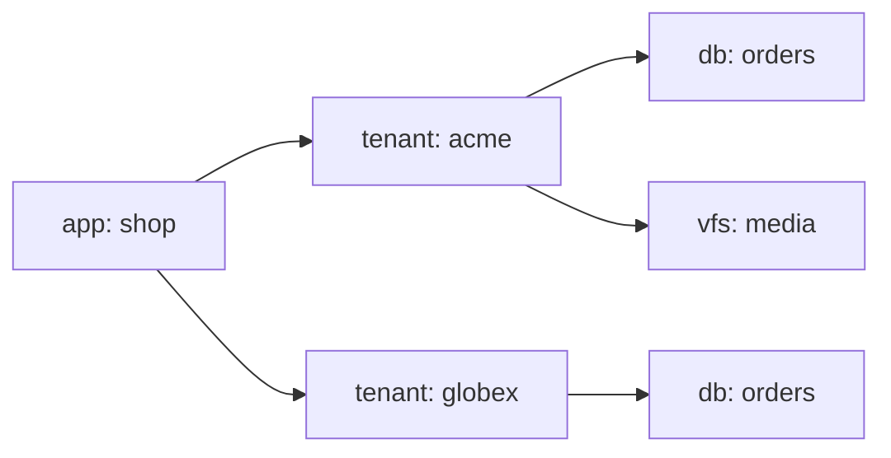
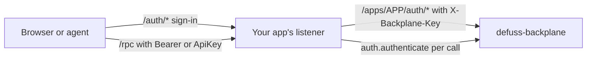

# defuss-backplane

Local, unified low-level persistence and logic layer RPC service for application service backend and MCP agents. One process serves [defuss-rpc](https://github.com/kyr0/defuss-rpc), MCP, streaming file routes, health probes and metrics on the same port through [defuss-serve](https://github.com/kyr0/defuss-serve). Each bucket belongs to one app, tenant and service.

## Quick start

Install the package in your application's directory.

```sh
npm install defuss-backplane
# or
bun add defuss-backplane
```

npm or bun also installs [defuss-vfs](https://github.com/kyr0/defuss-vfs), [defuss-logs](https://github.com/kyr0/defuss-logs), [defuss-scheduler](https://github.com/kyr0/defuss-scheduler) and the other runtime packages. The package bundles the [defuss-db](https://github.com/kyr0/defuss-db) engine code the daemon needs.

Create a private bot key once, in the directory where the daemon will run. The command writes `.env` with a random `API_KEY`, readable only by you, and fails instead of overwriting an existing `.env`. In a checkout of this repository, `make env` does the same from `.env.example`, with a `BACKPLANE_AUTH_MASTER_KEY` too, and `make setup` runs it. An existing `.env` keeps every line; it only gains a master key when it has none, and a key already set is never replaced, because it encrypts the auth stores. VERIFIED by tests/setup.test.ts. Restart the daemon after the key is added.

```sh
(umask 077; set -C; printf 'API_KEY=%s\n' "$(openssl rand -hex 32)" > .env)
```

Start one daemon with Node.js 26 or Bun 1.4.4 or later. The first command runs the installed CLI under Node.js. The second selects Bun explicitly.

```sh
node node_modules/defuss-backplane/dist/cli.js
# or
bun node_modules/defuss-backplane/dist/cli.js
```

The startup log prints the listener address. The default is `http://127.0.0.1:43127`. Give backend processes and local MCP clients the same bot key. Node.js callers can load their environment file with `node --env-file=.env`.

## Apps, tenants and buckets

Every piece of data lives at one address: app, tenant, bucket. Logs are the exception, with one log per app and one more per tenant.

```ts
// app: your service
const shopApp = await connectBackplane({ app: "shop" });
// tenant: one customer of that service
const acme = shopApp.tenant("acme");
// bucket: one named store in that tenant
const orders = acme.db("orders");
```



The two `orders` buckets in the diagram are separate stores: the same bucket name in another tenant or app never shares data. The names separate data but grant nothing, because every caller with the bot key can name any app and tenant. Your service decides with its own authentication which tenant a request may use.

## Services

An app service connects once and then uses any of these services in any tenant. The handles use `shopApp` and `acme` from the example above: `shopApp` is what `connectBackplane` returns, and `acme` is `shopApp.tenant("acme")`.

| Service | Handle | What an app keeps there | Details |
| --- | --- | --- | --- |
| Cache | `acme.cache(bucket)` | Values under a key, with an optional time to live: sessions, counters, computed results. | [Backend API](#backend-api) |
| Documents | `acme.db(bucket)` | Documents with generated or own IDs. Queries filter, sort, page and project, up to 1,000 rows each. | [Backend API](#backend-api) |
| Files | `acme.vfs(bucket)` | Files under path keys, of any size. Calls carry up to 1 MiB, and `upload` and `download` stream larger files. `/files` serves byte ranges, so a media player can seek. | [Files](#files) |
| Logs | `shopApp.logs()` for the app, `acme.logs()` for the tenant | One log for the app and one per tenant, filtered by level and time. A [defuss-logs](https://github.com/kyr0/defuss-logs) logger writes into them in batches. | [Logs](#logs) |
| Scheduler | `acme.scheduler(bucket)` | Cron schedules with time zones, retries and run history, and one-off jobs with deadlines and a hook per ending. At each run the daemon calls one of your RPC functions, or a worker of yours takes the run. | [Scheduling](#scheduling) |
| Auth | `shopApp.auth` to register, `acme.auth` per tenant | Your app's users, who sign in with email and password, and API keys for agents. Each call to your app is checked against live state. | [Authentication](#authentication) |

Cache, documents and files take a revision on writes, so two writers cannot overwrite each other unnoticed ([Conditional writes](#conditional-writes)). Over RPC, cache values, documents and log arguments keep native types such as dates, binary data and bigints. Scheduler payloads and results are JSON.

| Way in | For | Route |
| --- | --- | --- |
| Typed client `defuss-backplane/client` | App backends on Node.js or Bun | `/rpc` |
| MCP tools | Agents. `make mcp-config` writes their client entry. | `/mcp` |
| Plain HTTP | File streams, probes and metrics | `/vfs/object`, `/files`, `/readyz`, `/metrics` |
| Auth routes | Your app's proxy for its browser's sign-in | `/apps/<app>/auth/*` |

Every route needs the root key or a bot key, except the probes and the auth routes, which want your app's key in `X-Backplane-Key`. The daemon listens on 127.0.0.1 only.

## Security

The backplane relies on two things: its keys, and that only processes on the same machine can reach it.

| Protection | What it means for you |
| --- | --- |
| Root key `API_KEY` | Every request needs `Authorization: Bearer <API_KEY>` or a bot key, except the health probes and the auth routes. A missing or wrong key gets 401. The daemon does not start without a root key. `make env` creates a random 32-byte key in `.env`, readable only by you. |
| Root key, full access | The root key reaches every app and tenant, their schedules included, and manages the bots. Keep it for operators and local agents, never a browser or a user. `make mcp-config` writes it into `.mcp.json`, readable only by you and ignored by Git. |
| One bot per app | `bots.create({ name, apps: ["shop"] })` returns a key that reaches only the apps it names, over RPC, MCP and both file routes; another app's scope gets 403. `/metrics` shows such a bot only its apps' lines and those that name no app. Give each app service its own bot key, sent as `Authorization: ApiKey <key>`; `make bot APP=<name>` creates one on the running daemon with the root key from `.env`. A bot with `admin: true` reaches every app and manages bots. Bot keys expire after 90 days, so rotate them before with `bots.rotate`. |
| Master key | `BACKPLANE_AUTH_MASTER_KEY` encrypts the bots' and every app's signing keys. Back it up with the data root. VERIFIED by defuss-auth's tests: under another master key, stored signing keys fail to decrypt, so no app can sign anyone in. |
| Loopback only | The daemon listens on 127.0.0.1, so no other machine can connect. `PORT` changes the port, never the host. |
| Host check | A request whose `Host` is not 127.0.0.1 or localhost at the daemon's port gets 403. A web page whose domain resolves to 127.0.0.1 still cannot pass. |
| No browsers | Any request with an `Origin` header gets 403, even with a key, so no web page can call the daemon. A browser reaches files only through your backend, which checks its own users and then proxies `/files`. The auth routes take `Origin`, because cookie-mode sign-in needs it, but only from your app's proxy with its key. |
| Callbacks | A schedule may call only loopback URLs or the origins in `BACKPLANE_CALLBACK_ORIGINS`. Each call carries a one-time token instead of a key; your app checks it with `callbacks.verify`. A redirect fails the call. The typed client refuses redirects too. |
| Your users | Each app has its own users, in its own store. Your service forwards sign-in to the backplane, asks it who sent each call, and decides what that user may do. |

The data on disk is not encrypted. [ARCH.md](ARCH.md) covers file modes, retention and personal data under "Security and operations".

## Backend API

```ts
import { connectBackplane } from "defuss-backplane/client";

const shopApp = await connectBackplane({ app: "shop" });
const tenant = shopApp.tenant("acme");
const cache = tenant.cache("catalog");
await cache.set("currency", "EUR", 60_000);
const cached = await cache.get("currency"); // { hit: true, value: "EUR" }

const orders = tenant.db("orders");
const id = await orders.insert({ item: "A7", status: "open" });
await orders.update(id, { status: "paid" });
const page = await orders.query({
  filters: [{ field: "status", op: "eq", value: "paid" }],
  sorters: [{ field: "item", direction: "asc" }],
  projection: ["id", "item"],
  limit: 25,
});
console.log(cached, page.rows);
```

| Operation | Result |
| --- | --- |
| `cache.get(key)` | `{hit:false}` for a missing or expired key, otherwise `{hit:true,value}`. |
| `cache.getVersioned(key)` | Returns the value and revision, or `{found:false,revision:null}`. |
| `cache.set(key,value,ttlMsOrOptions?)` | Overwrites the value and returns true. Omitting TTL clears any previous expiry. Zero expires immediately. |
| `cache.delete(key,options?)` | Returns true after the storage operation, including when the key is absent. |
| `db.insert(document,options?)` | Returns the primary key. The database generates one when the document omits `id`. |
| `db.get(id)` | Returns the document or null. |
| `db.getVersioned(id)` | Returns the document and revision from one snapshot, or `{found:false,revision:null}`. |
| `db.update(id,patch,options?)` | Patches fields and returns whether a document was updated. The ID is immutable. |
| `db.delete(id,options?)` | Returns whether a document was deleted. |
| `db.query(request?)` | Returns `{rows}` with filters, sorters, offset, limit and optional top-level field projection. Default limit 100, maximum 1,000. |

The client sends credentials on its initial schema request and subsequent calls. It sends each immutable scope with the operation. RPC accepts DSON values, including dates and binary data.

### Plain defuss-rpc

`connectBackplane` is a typed layer over a defuss-rpc client. Its handles bind the scope, turn failures into `BackplaneError`, refuse redirects, read `PORT` and `API_KEY`, stream files and adapt logs and the scheduler to defuss-logs and defuss-scheduler. Without that layer, the package's `BackplaneApi` type types a plain [defuss-rpc](https://github.com/kyr0/defuss-rpc) client, and every method takes the scope first.

```ts
import type { BackplaneApi } from "defuss-backplane/client";
import { createRpcContext } from "defuss-rpc/client";

const rpc = await createRpcContext({
  baseUrl: "http://127.0.0.1:43127",
  headers: { Authorization: `Bearer ${process.env.API_KEY}` },
}).getRpcClient<BackplaneApi>();
const scope = { app: "shop", tenant: "acme", bucket: "catalog" };
await rpc.cache.set(scope, "currency", "EUR");
const page = await rpc.db.query(scope, { limit: 25 });
```

A failed call then throws defuss-rpc's error, which carries the daemon's HTTP `status` and its JSON `body` with `code`. Logs take `{ app, tenant? }` as their scope.

## Authentication

The backplane hosts sign-in for your app on [defuss-auth](https://github.com/kyr0/defuss-auth). Your app keeps its own origin: its listener forwards `/auth/*` to the backplane, and its API asks the backplane who sent each call. The browser never talks to the backplane.



```ts
import { connectBackplane } from "defuss-backplane/client";
import { createServer } from "defuss-serve";

// The app's own bot key from bots.create, in its .env.
const shopApp = await connectBackplane({ app: "shop", apiKey: process.env.BACKPLANE_API_KEY });
await shopApp.auth.configure({ origin: "https://shop.example" });
// /auth/* of the app's listener goes to the backplane, with the app's key.
const server = createServer({ host: "127.0.0.1", port: 3000, plugins: [shopApp.auth.proxy() /* , your routes */] });
// In each API call: who sent it, in the tenant it acts in.
const who = await shopApp.tenant("acme").auth.authenticate(request.headers.get("authorization") ?? "");
```

`configure` registers the app with its public origin, the only origin whose pages may send sign-in writes; calling it again with a new origin or mode changes it. It also takes `mode`: `cookie` (default) keeps the refresh token in an HttpOnly cookie on your origin, and `token` hands it to the page. WebKit drops `Secure` cookies over plain HTTP, so use `token` there or serve HTTPS. The daemon reopens every registered app after a restart. `auth.proxy()` is a [defuss-serve](https://github.com/kyr0/defuss-serve) plugin that mounts at `/auth`, the refresh cookie's path, and sends the connection's key in `X-Backplane-Key`; with another server, forward `/auth/*` to `/apps/<app>/auth/*` with that field yourself. In the browser, `createAuthClient({ baseUrl: location.origin + "/auth" })` from `defuss-auth/client` signs in and refreshes.

`authenticate` checks a `Bearer` access token or an `ApiKey` against live state, so a revoked key or a removed member fails on the next call. It returns `{ app, subjectId, subjectKind, tenantId, claims, method, credentialId, sessionId }` and fails for a credential of another tenant. There is no email delivery, so there is no self sign-up and no password reset. Accounts come from these calls:

| Call on `acme.auth` | What it does |
| --- | --- |
| `addMember({ email, password?, claims? })` | Grants the person access to the tenant with `claims`, creating the account if the email is new. The password applies to a new account only. |
| `removeMember(subjectId)` | Ends the person's access to the tenant. Their tokens fail on the next call. |
| `setPassword(subjectId, password)` | Replaces a member's password. At least 15 characters. |
| `createApiKey({ name, claims? })` | A service account in the tenant with one key, for an agent. The key is returned once. |
| `listApiKeys()`, `revokeApiKey(id)` | The tenant's agent keys, and ending one. |
| `members({ limit?, after? })` | A page of the tenant's members as `{ items, next }`, each with `subjectId`, `email`, `status`, `claims` and times; pass `next` as `after` for the following page. A page can hold fewer than `limit` items, because accounts of other tenants are skipped. |

`shopApp.auth.status()` says whether auth is on and how the app registered: `{ app, enabled, configured, origin, mode, issuer, audience }`, the last four once it is configured. It answers while auth is off, so it shows why the other calls fail.

Agents debug sign-in over MCP with four read-only tools: `auth.status`, `auth.members`, `auth.listApiKeys` and `bots.list`. They show no password, session or key secret, and a bot reads only its own apps. Every call that creates or changes an account, a key or a bot stays RPC-only. Why not MCP for those too: a new key or password would land in the agent's transcript, and whoever holds the root key makes them over RPC. VERIFIED by tests/auth.test.ts.

App names for auth are lowercase letters, digits, `-` and `_`, and tenant names letters, digits, `-` and `_` up to 48 characters; others get `INVALID_ARGUMENT`. Without `BACKPLANE_AUTH_MASTER_KEY`, every auth and bot call but `auth.status` answers `UNAVAILABLE`.

## Conditional writes

Read a revision when a backend or agent will edit a value. A hit returns `{found:true,value,revision}`. Pass the token to the write. A competing update or delete returns `REVISION_CONFLICT`. Read again and decide whether the edit still applies.

```ts
const order = await orders.getVersioned(id);
if (order.found) {
  await orders.update(id, { status: "shipped" }, { ifRevision: order.revision });
}
await cache.set("job-7", { state: "claimed" }, { ttlMs: 30_000, ifRevision: null });
```

Omitting `ifRevision` keeps the v0.1 write behavior. A null token requires logical absence, including an expired cache key. An insert accepts null or an omitted condition and always creates a new row. An update of an absent row returns false if its precondition passes. Recreating a deleted item issues a fresh token even for identical contents. A token applies to one item, survives daemon restarts, and remains valid across writes to other items. Route all edits through the daemon when using revisions. Native readers can still open the document store. A typed collection requires an explicit ID when its declared ID type excludes arbitrary strings.

## Logs

Each app has a log, and each of its tenants has one more. `client.logs()` writes and reads the app's log, and `client.tenant(name).logs()` that tenant's. [defuss-logs](https://github.com/kyr0/defuss-logs) stores the records, and DSON keeps the types of their arguments.

```ts
import { createBatchSink, createLogger } from "defuss-logs/client";

const backplane = await connectBackplane({ app: "shop" });
const acme = backplane.tenant("acme").logs();
const logger = createLogger({ sink: createBatchSink(acme), parallelSink: true, context: { service: "checkout" } });
logger.console.warn("payment %s declined", paymentId, { amount: 12n, at: new Date() });
await logger.flush();

const { records, nextAfter } = await acme.read({ levels: ["warn", "error"], limit: 50 });
```

The handle is a [defuss-logs](https://github.com/kyr0/defuss-logs) batch writer. A logger in the application formats, redacts and batches its records, and each batch becomes one RPC call of at most 256 KiB of encoded records, which keeps it below the 1 MiB request limit. Install [defuss-logs](https://github.com/kyr0/defuss-logs) in the application to import `createLogger`.

| Operation | Result |
| --- | --- |
| `logs.write(entries)` | Appends 1 to 1,000 entries in one transaction and returns `{written}`. An entry needs `level` (`trace`, `debug`, `info`, `warn`, `error` or `fatal`) and `message`. It may carry `args`, `context`, a `ts` Date and an `id`, which must be a UUID. The daemon assigns a missing `id` and `ts`. An entry that repeats a stored `ts` and `id` fails the whole call with `ALREADY_EXISTS`. |
| `logs.read(request?)` | Returns `{records,nextAfter}` in time order. `from` is inclusive and `before` exclusive. `levels` filters, and `limit` defaults to 100 with a maximum of 1,000. Pass `nextAfter` as `after` for the next page. |

Records of the same millisecond come back in the order of their IDs, not of their writes. The MCP tools `logs.write` and `logs.read` take a scope of `app` and an optional `tenant`. Over MCP the daemon stamps each entry, and timestamps travel as ISO-8601 strings. Reading a record whose arguments hold dates, binary or bigint values needs `resultEncoding: "dson"`. The daemon neither rotates nor expires logs, so a log grows until its directory is deleted.

### Reserved app names

App names starting with `_` belong to the defuss libraries, so any call that uses one fails with `INVALID_ARGUMENT`, with one exception for reading. The daemon writes its own lines to the app log of `_backplane`: startup, shutdown, listener diagnostics, scheduler faults, failed OTLP exports, and calls or transfers that fail with a server error other than `BUSY`. It also prints each line to stdout, or stderr for warnings and errors. Any caller with the bot key can read that log with `logs.read` and the scope `{app: "_backplane"}`, for example `connectBackplane({ app: "_backplane" })` followed by `.logs().read()`, so agents and people can debug the daemon. Writing it fails with `INVALID_ARGUMENT`, and it has no tenant logs. After the daemon stops, [defuss-logs](https://github.com/kyr0/defuss-logs) also reads it from `_backplane/logs` under the data root. A daemon that fails to start prints the error to stderr only. [defuss-rpc](https://github.com/kyr0/defuss-rpc) and [defuss-mcp](https://github.com/kyr0/defuss-mcp) print their own lines to the console, which reach stdout and stderr but not the log.

## Scheduling

Every daemon runs one [defuss-scheduler](https://github.com/kyr0/defuss-scheduler) authority for all apps, tenants and buckets. `tenant.scheduler(bucket)` returns a [defuss-scheduler](https://github.com/kyr0/defuss-scheduler) queue. An app either lets the daemon call one of its RPC functions at each occurrence, as described under RPC callbacks, or runs `startWorker` against the queue.

```ts
import { startWorker } from "defuss-scheduler/worker";

const jobs = tenant.scheduler("jobs");
await jobs.create(
  { id: "nightly", cron: "0 2 * * *", timezone: "Europe/Berlin", handler: "rollup", payload: { days: 1 } },
  { requestId: "create-nightly" },
);
const worker = startWorker(jobs, {
  workerId: "rollup-1",
  handlers: { rollup: async (run) => ({ rolledUp: run.payload }) },
});
process.once("SIGTERM", () => void worker.stop());
```

| Operations | Reached through | Purpose |
| --- | --- | --- |
| `create`, `get`, `list`, `update`, `pause`, `resume`, `remove` | RPC and MCP | Manage schedules. A definition can carry a `ref`, a name several schedules share, and `list` and `listRuns` filter by it. |
| `submit`, `getJob` | RPC and MCP | Queue a one-off job and read it by its ID, with its state, attempt, error and result. |
| `getRun`, `listRuns` | RPC and MCP | Read runs with their state, attempt, error, result and timestamps. |
| `scheduleHistory`, `runHistory` | RPC and MCP | List every definition and state a schedule had, and every status a run went through, newest first. A run's history is erased with the run when its retention ends. |
| `terminate` | RPC and MCP | Stop one run, one job, one schedule, everything with a ref or the whole bucket at once, and record the cause on each. |
| `claim`, `renew`, `complete`, `fail` | RPC only | Lease runs and report on them. `startWorker` calls these. |

Edits take `change: { revision, requestId }`. A stale revision fails with `REVISION_CONFLICT`, an ID already in use with `ALREADY_EXISTS`, and an edit of an unknown schedule with `NOT_FOUND`. After an ambiguous response, repeat the call with the same request ID and arguments. Payloads and results are JSON. The [defuss-scheduler](https://github.com/kyr0/defuss-scheduler) documentation covers cron syntax, time zones, retries and worker shutdown. Install [defuss-scheduler](https://github.com/kyr0/defuss-scheduler) in the worker's application to import `startWorker`. Handler names starting with `_` belong to the daemon: a schedule cannot use one other than `_rpc`, and a worker cannot claim them.

### Jobs

A job is work to be done once, without a cron, under an ID of the app's. Any process that holds the app's bot key pulls jobs with `startWorker`, so an app scales its work across processes and containers on the daemon's host. `poolHandlers` from defuss-scheduler runs each job in a worker thread of a [defuss-multicore](https://github.com/kyr0/defuss-multicore) pool, off the event loop that renews the lease. Each ending, `succeeded`, `dead`, `timedOut` or `terminated`, can admit a follow-up job; with handler `_rpc` it calls one of the app's RPC functions, a hook.

```ts
import { Worker } from "node:worker_threads";
import { createPool } from "defuss-multicore";
import { poolHandlers, startWorker } from "defuss-scheduler/worker";
import { rpcCalls } from "defuss-rpc/client";
import type { RpcApi } from "./api.ts";

const renders = (await connectBackplane({ app: "shop", apiKey: process.env.BOT_KEY })).tenant("acme").scheduler("render");
const calls = rpcCalls<RpcApi>();
const hook = (job: string) => ({ handler: "_rpc", payload: { url: "http://127.0.0.1:3000/rpc", ...calls.Renders.ended(job) } });
await renders.submit({
  id: "page-42",
  handler: "render",
  payload: { page: 42 },
  timeoutMs: 600_000,
  on: { succeeded: hook("page-42"), dead: hook("page-42"), timedOut: hook("page-42") },
});

// In each worker process:
const pool = createPool({ worker: () => new Worker(new URL("./render-tasks.js", import.meta.url)), maxWorkers: 4 });
startWorker(renders, { workerId: "render-1", concurrency: 4, handlers: poolHandlers(pool, ["render"]) });

// Later, or in the hook:
const job = await renders.getJob("page-42"); // state, attempt, lastError and, once it succeeded, result
```

The defuss-scheduler documentation covers the job fields, deadlines, retention and why follow-ups cannot be lost. The daemon checks every `_rpc` payload of a job and its follow-ups at `submit`, so a hook to an address it would refuse fails with `INVALID_ARGUMENT` at once. A bot submits and pulls only in its own apps. A hook's token verifies to `{ ..., schedule: null, job: null, cause: { job, run, state } }`, so the app learns which job ended and how from the daemon, not from the request. Its `X-Backplane-Job` header names the job too. A job whose own handler is `_rpc` is an RPC call made once, and its token names the job in `job`.

VERIFIED by tests/jobs.test.ts and by the packed-consumer test on each of its three daemon phases: a Node.js and a Bun worker process with one bot key shared 20 jobs, and all 23 endings reached the hook with a verified cause. VERIFIED by probe on 2026-11-26: 200 idle worker slots polling an empty queue sent 714 claims per second and cost the daemon 2.0 seconds of CPU in 10 seconds, about a fifth of one core. Under Bun, use defuss-multicore 0.1.1 or later: a 0.1.0 pool on `node:worker_threads` never answers there.

### RPC callbacks

A schedule with handler `_rpc` needs no worker and no cron of the app's own. At each occurrence the daemon calls the [defuss-rpc](https://github.com/kyr0/defuss-rpc) function that the payload names, with the payload's arguments. Build the call with defuss-rpc's `rpcCalls` from your API type, so a renamed function or a wrong argument fails to compile, and the wire format stays defuss-rpc's business.

```ts
import { rpcCalls } from "defuss-rpc/client";
import type { RpcApi } from "./api.ts"; // the namespace object your app serves

const calls = rpcCalls<RpcApi>();
await tenant.scheduler("jobs").create({
  id: "nightly-report",
  cron: "0 2 * * *",
  timezone: "Europe/Berlin",
  handler: "_rpc",
  payload: { url: "http://127.0.0.1:3000/rpc", ...new calls.ReportApi().nightly({ days: 1 }) },
});
```

The payload is the callback's `url` plus the call, `{ v, className, methodName, args }`, which agents read as plain JSON. A payload without `v`, written before defuss-rpc versioned its calls, still runs, and a `v` that defuss-rpc does not know fails `create` with `INVALID_ARGUMENT`. The daemon sends the call with defuss-rpc's `encodeRpcCall`: `POST` to `url` with the DSON body. Its headers are `X-Backplane-Callback`, `X-Backplane-Schedule` for a schedule's run, `X-Backplane-Job` for a job and a job's follow-up, `X-Backplane-Run` and `X-Backplane-Attempt`. `X-Backplane-Callback` is a one-time token: while the call runs, `shopApp.callbacks.verify(token)` returns `{ app, tenant, bucket, schedule, job, cause, run, attempt }`, and after it, or for another app's key, `NOT_FOUND`. The app refuses a call whose token does not verify. Delivery is at least once, so the app should drop a run ID it has already handled. The run stores `{status, result}`, where `result` is the function's return value when it is JSON and null otherwise.

`url` must use http or https on `127.0.0.1`, `localhost` or `[::1]`, or an origin listed in `BACKPLANE_CALLBACK_ORIGINS`, so a key holder cannot make the daemon call any address. A payload that breaks these rules fails `create` or `update` with `INVALID_ARGUMENT`. A call fails after 60 seconds or on a redirect. An answer with status 2xx completes the run. A 4xx answer other than 408 and 429 fails it for good. Other failures retry within the schedule's retry policy. Each failed call logs a `WARN` line to the `_backplane` log. The daemon checks for due callbacks every 250 ms.

## Files

`tenant.vfs(bucket)` stores files as objects under relative path keys. Calls through `/rpc` and MCP carry at most 1 MiB. `upload` and `download` stream objects of any size through `/vfs/object`.

```ts
import { createReadStream, createWriteStream } from "node:fs";
import { Writable } from "node:stream";

const media = tenant.vfs("media");
await media.put("notes/today.txt", "Call the supplier");
const listing = await media.list({ prefix: "notes/" });

await media.upload("videos/intro.mp4", createReadStream("intro.mp4"), { ifRevision: null });
const video = await media.download("videos/intro.mp4");
if (video.found) await video.stream.pipeTo(Writable.toWeb(createWriteStream("copy.mp4")));
```

| Operation | Result |
| --- | --- |
| `vfs.put(key,data,options?)` | Stores a string or bytes as one object and returns `{key,size,revision,mtimeMs}`. |
| `vfs.get(key,range?)` | Returns the bytes with that metadata, or `{found:false,revision:null}`. An object over 1 MiB needs a `{offset,length}` range or `download`. |
| `vfs.head(key)` | Returns the metadata without the bytes. |
| `vfs.list(request?)` | Returns `{objects,nextAfter}` in bytewise key order. `prefix`, `after` and `limit` (default 100, maximum 1,000) select a page. Pass `nextAfter` as `after` for the next page. |
| `vfs.delete(key,options?)` | Returns whether an object was deleted. |
| `vfs.upload(key,body,options?)` | Streams a `ReadableStream`, an async iterable such as a Node.js file stream, a `Blob`, bytes or a string, and returns the metadata. |
| `vfs.download(key)` | Returns the metadata with a `stream` of the bytes, or `{found:false,revision:null}`. Read or cancel the stream. |

A key is a relative path of 1 to 1,024 valid UTF-8 bytes without empty, `.` or `..` segments. A key cannot hold an object while it is also the directory of other keys: with `a/b` stored, writing `a` fails with `INVALID_ARGUMENT`, and reading `a` finds nothing. Writes take `ifRevision` as described above. Every successful write issues a new revision, even for unchanged content. An upload replaces the previous object only after its last byte arrives, so a failed upload leaves the previous object and revision in place.

The streaming endpoint takes the scope and key as URL-encoded query parameters. `PUT` stores the request body and returns the metadata as JSON. `GET` returns the bytes with `Content-Length`, the revision as a quoted `ETag` and the modification time in `X-Mtime-Ms`. A missing object returns 404 with code `NOT_FOUND`. `If-Match: "<revision>"` and `If-None-Match: *` are the HTTP forms of a revision token and of `ifRevision: null`.

```sh
object='http://127.0.0.1:43127/vfs/object?app=shop&tenant=acme&bucket=media&key=videos%2Fintro.mp4'
curl -fsS -T intro.mp4 -H "Authorization: Bearer ${API_KEY}" "$object"
curl -fsS -o copy.mp4 -H "Authorization: Bearer ${API_KEY}" "$object"
```

### Files over plain HTTP

`GET` and `HEAD` on `/files/<app>/<tenant>/<bucket>/<key>` read an object with standard HTTP, so curl, a fetch call or a proxy in front of a media player can stream and seek. Percent-encode each path segment; the slashes of the key stay as they are. The route needs the same bot key as every other route, so a browser reaches it only through the application backend, which checks its own user and forwards the request with the key.

```sh
curl -fsS -r 0-1048575 -H "Authorization: Bearer ${API_KEY}" \
  -o head.mp4 http://127.0.0.1:43127/files/shop/acme/media/videos/intro.mp4
```

| Request header | Answer |
| --- | --- |
| none | 200 with the whole object, `ETag`, `Last-Modified`, `Accept-Ranges: bytes` and `Cache-Control: private, no-cache`. |
| `Range: bytes=<first>-<last>`, `bytes=<first>-` or `bytes=-<suffix>` | 206 with `Content-Range`. A range past the end returns 416 with `Content-Range: bytes */<size>`. Several ranges in one header get the whole object. |
| `If-Range: "<revision>"` | The range when the revision still matches, else the whole object. A date there always gets the whole object. |
| `If-None-Match` or `If-Modified-Since` | 304 without a body when the object is unchanged. |
| `If-Match` or `If-Unmodified-Since` | 412 when the object changed. |

`Content-Type` follows the key's extension for common image, audio, video, PDF, text, CSV and JSON files. Every other file is sent as `application/octet-stream` with `X-Content-Type-Options: nosniff`, so HTML, SVG and scripts that a tenant stored cannot run on the site that proxies them. `X-Size` repeats the object size, because Bun sends streamed bodies without `Content-Length`. A missing object returns 404 with code `NOT_FOUND`. An app, tenant or bucket whose name contains `/` is reachable only through RPC, because the listener rejects an encoded slash in a path.

### Errors

RPC error bodies carry `{code,error,status}`. The SDK throws `BackplaneError` with `code`, `message`, and `status`. MCP tool failures set `isError` and carry `{code,message,status}` in `structuredContent`. MCP transport and JSON-RPC protocol failures use their protocol-defined envelopes.

| Code | RPC status | Caller action |
| --- | --- | --- |
| `INVALID_ARGUMENT` | 400 | Correct the arguments. |
| `UNAUTHORIZED` | 401 | Send the root key as `Bearer`, or a live bot key as `ApiKey`. From `auth.authenticate`: the user's credential is unknown, expired or revoked. |
| `FORBIDDEN` | 403 | Use the loopback URL and port, and send no Origin header. |
| `NOT_FOUND` | 404 | Check the endpoint path. A download of a missing object, through either file route, or an edit of an unknown schedule also returns this code. An unknown path gets a plain-text `Not Found` from the listener instead of a JSON body. |
| `METHOD_NOT_ALLOWED` | 405 | Use the method named in the `Allow` header. |
| `ALREADY_EXISTS` | 409 | Choose a different ID or edit the existing row or schedule. A log batch that fails this way was already stored. |
| `REVISION_CONFLICT` | 409 | Read the current version before deciding whether to retry. |
| `RATE_LIMITED` | 429 | Too many failed sign-ins for one account or client. Wait for the window to pass. |
| `PAYLOAD_TOO_LARGE` | 413 | Keep `/rpc` and `/mcp` requests under 1 MiB. Stream larger files through `/vfs/object`. The daemon reads an oversized body to its end before it answers, so the sender receives this code instead of a broken connection. |
| `BUSY` | 503 | Retry with backoff. Repeat a scheduler call with the same request ID and arguments. |
| `UNAVAILABLE` | 503 | Auth is off: set `BACKPLANE_AUTH_MASTER_KEY`. |
| `COMMIT_UNCERTAIN` | 500 | Inspect the persisted value before issuing another write. Repeat a scheduler call with its original request ID. |
| `STORAGE_ERROR` | 500 | Inspect the store and filesystem. |
| `INTERNAL_ERROR` | 500 | Retry once. Report repeated failures with the daemon log. |
| `DSON_REQUIRED` | 422 equivalent in an MCP tool result | Repeat the read with DSON encoding. |

## Local curl and MCP

With `API_KEY` in the shell environment, curl can inspect the RPC schema or populate a cache key.

```sh
curl -fsS -X POST -H "Authorization: Bearer ${API_KEY}" http://127.0.0.1:43127/rpc/schema
curl -fsS -H "Authorization: Bearer ${API_KEY}" http://127.0.0.1:43127/rpc \
  --json '{"className":"cache","methodName":"set","args":[{"app":"shop","tenant":"acme","bucket":"catalog"},"currency","EUR"]}'
```

Configure the agent's Streamable HTTP transport with endpoint `http://127.0.0.1:43127/mcp` and the same Authorization header. In the source tree, `make mcp-config` writes this entry into `.mcp.json`, the project file Claude Code reads, with `PORT` and `API_KEY` from `.env`:

```json
{"mcpServers":{"defuss-backplane":{"type":"http","url":"http://127.0.0.1:43127/mcp","headers":{"Authorization":"Bearer <API_KEY>"}}}}
```

The file is gitignored and written with mode 600, because it holds the bot key. Entries of other servers stay; linear-clone's `make mcp-config` adds its own entry to the same file. The packed-consumer test connects from a file that `make mcp-config` wrote for its throwaway daemon.

Tool discovery lists the ten cache and document operations, `vfs.put`, `vfs.get`, `vfs.head`, `vfs.list` and `vfs.delete`, `logs.write` and `logs.read`, the fourteen `scheduler.` tools for schedules and jobs, and the read-only `auth.status`, `auth.members`, `auth.listApiKeys` and `bots.list`, each with its input schema. For example, call `cache.get` with these arguments.

```json
{"scope":{"app":"shop","tenant":"acme","bucket":"catalog"},"key":"currency"}
```

The result is available as `structuredContent.value`. A native value that would lose information in JSON requires `resultEncoding: "dson"` on the read. The value then contains a `dson` string. Shared references, cycles, dates, binary and bigint values can require this mode. MCP keyed document operations accept a string, number, or a tagged bigint such as `{"bigint":"9007199254740993"}`. The tag is also accepted as `document.id` on insert, which returns the tag for a bigint ID. Reading such a document with `resultEncoding: "dson"` preserves the native ID. Conditional MCP writes take `ifRevision` at the top level alongside `scope` and `key` or `id`. Ordinary MCP writes accept JSON. RPC supports DSON for reads and writes. The VFS tools exchange object content as a string: `encoding` selects `utf8`, the default, or `base64` for binary. A `utf8` read of bytes that are not valid UTF-8 fails with `INVALID_ARGUMENT`.

## Health and metrics

[defuss-o11y](https://github.com/kyr0/defuss-o11y) reports the daemon's health and every call it serves. A supervisor on the same host polls the probes without the bot key. The scrape needs the key because it names apps. All of these routes reject a foreign Host or any Origin with 403, like the other routes.

In a checkout, the verbs below ask the daemon `make start` runs, at the URL its `listening` line names.

| Verb | Asks | Prints |
| --- | --- | --- |
| `make health` | `/readyz` | The probe's answer as JSON, with the HTTP status. Exits 1 unless it passes. |
| `make healthz` | `/livez` | The same for liveness. |
| `make metrics` | `/metrics`, with `API_KEY` from `.env` | The Prometheus text. `make metrics APP=shop` keeps the lines of one app. |

| Path | Bot key | Answer |
| --- | --- | --- |
| `/readyz`, `/health` | not needed | 200 when every check passes, else 503. The `storage` check needs write access and free space on the data root's volume. |
| `/livez`, `/healthz` | not needed | 200 while the process answers. |
| `/metrics` | required | Prometheus text format 0.0.4. |

A probe returns `{"service":"defuss-backplane","status":"pass","checks":[{"name":"storage","status":"pass"}]}`. A failed check reports only its name and a reason code, never the error.

| Prometheus name | Kind | Labels | Measures |
| --- | --- | --- | --- |
| `backplane_operation_duration` | histogram, seconds | `module` (cache, db, vfs, logs or scheduler), `method`, `app`, `code` (`OK` or an error code) | Each service call over RPC and MCP. `_count` gives calls and faults per app. |
| `http_server_request_duration` | histogram, seconds | `endpoint` (rpc, mcp, vfs-object, files, probes, metrics, or `http` for the listener's own 403 and 404), `http_request_method`, `http_response_status_code` | Time until the response headers, so a streamed body's transfer time is not included. |
| `backplane_storage_free` | gauge, bytes | none | Space available on the data root's volume. |
| `backplane_store_handles` | gauge | `module` (cache, db, vfs or logs), `state` (busy or idle) | Open store handles. A module keeps at most 32 and answers `BUSY` beyond that. |
| `backplane_http_active` | gauge | `kind` (requests, streams or uploads) | Requests in progress, response bodies streaming and request bodies arriving. |
| `backplane_callback_duration` | histogram, seconds | `app`, `outcome` (`ok`, `failed` or `rejected`) | Each RPC callback. A failed call is retried, a rejected one is not. |
| `backplane_scheduler_errors_total` | counter | none | Faults of the scheduler's background loop, each also logged as an `ERROR` line. It exists from startup at 0, so a rate alert has data before the first fault. |

[defuss-o11y](https://github.com/kyr0/defuss-o11y) adds process uptime, resident memory, readiness, and success per check and per gauge callback. An unknown HTTP method is counted as `_OTHER`, and a call whose scope is invalid has no `app` label. Tenant, bucket and key names never appear in a label. OTLP keeps the dotted names, such as `backplane.operation.duration`. Prometheus output carries the unit in a `# UNIT` line instead of a name suffix.

The listener stays on 127.0.0.1, so a Prometheus server on another host cannot scrape it. Run a Collector on the same host to scrape `/metrics`, or start the daemon with `BACKPLANE_OTLP=1` to push OTLP/HTTP JSON every 60 seconds and once at shutdown. The OpenTelemetry SDK reads the target from `OTEL_EXPORTER_OTLP_METRICS_ENDPOINT`, default `http://localhost:4318/v1/metrics`. [defuss-o11y](https://github.com/kyr0/defuss-o11y) documents `OTEL_EXPORTER_OTLP_METRICS_HEADERS` for a receiver that needs credentials. An export that takes longer than 1.5 seconds fails and logs a `WARN` line, so the final export cannot hold up a stop.

## Configuration

| Setting | Meaning |
| --- | --- |
| `API_KEY` | Required root key. Use printable ASCII without whitespace. Every holder may access every tenant. |
| `BACKPLANE_AUTH_MASTER_KEY` | Base64url of 32 random bytes, which `make env` and `make setup` write. Unset, auth and bots are off; malformed, startup stops. Back it up with the data root. |
| `PORT` | Listener port, default 43127. The host is fixed. |
| `BACKPLANE_DATA_DIR` | Data root, default `./var/data` relative to the daemon working directory. |
| `BACKPLANE_CALLBACK_ORIGINS` | Comma-separated origins besides loopback, such as `https://app.internal:8443`, that RPC callbacks may call. An entry that is not exactly an origin stops startup. |
| `BACKPLANE_OTLP` | `1` pushes metrics over OTLP/HTTP. Default `0`. Any other value stops startup. |
| `OTEL_EXPORTER_OTLP_METRICS_ENDPOINT` | The full OTLP metrics URL when `BACKPLANE_OTLP=1`. |

App, tenant and bucket identifiers accept 1 to 48 valid UTF-8 bytes, and an app name must not start with `_`. Each appears on disk as a lowercase slug in its own script, `-` and 8 hex digits of its hash, such as `acme-gmbh-033aedd8` for `Acme GmbH`. Cache keys and file keys accept 1 to 1,024 valid UTF-8 bytes. Stop the service with `SIGTERM` or `SIGINT`. To back up the whole service, stop writers, shut down the daemon, then copy the data root. An application's own authentication determines which tenant it passes to the service.

## Example app

[examples/linear-clone](examples/linear-clone/README.md) is an issue tracker that keeps all its state in the backplane. It uses db, cache, vfs, logs and the scheduler with RPC callbacks, and serves its API over [defuss-rpc](https://github.com/kyr0/defuss-rpc) and MCP.

## Development

Install the versions in `mise.toml`, then run `make setup` and `make verify`. The latter runs lint, type checking, real storage and protocol tests, coverage, and a packed-consumer test across Node.js and Bun. The sources, tests and verification scripts are TypeScript. The strict compiler checks all three, so lint fails when a test or script calls the API with the wrong types. The packed-consumer test needs `curl`, `lsof` and npm on the `PATH`. `make setup` also creates a missing `.env` from `.env.example` with a random `API_KEY`, readable only by you. It never rewrites an existing one. Use `make start` for the Node.js daemon or `make start RUNTIME=bun` for Bun. `make start` builds quietly and prints one JSON object with the state, pid and URL. Without `.env` it reports `"state":"unconfigured"` with `"fix":"make setup"`. A daemon that exits at startup is reported as `"state":"dead"` with its last stderr lines. `make status` prints the same object and exits 1 only for a dead daemon. `make log`, or `make logs`, prints the last N=50 entries of stdout and stderr merged by time, one JSON object per line with `ts`, `stream`, `level`, `msg` and `fields`. `make health`, `make healthz` and `make metrics` ask the running daemon, as described under Health and metrics, and `make results` prints the last packed-consumer report. `make stop` stops the source-tree daemon. `FORMAT=text` prints readable lines instead of JSON.

### Deep suite

`scripts/deep/run.ts` tests every subsystem through RPC and through MCP, and the plain HTTP routes once. It writes only to the tenant `_e2e_test_backplane` of the app `deep-e2e`, in buckets named after the run, and deletes its cache keys, documents and files. Log records and terminated schedules stay, because the daemon deletes neither. A full run fails when an RPC method, an MCP tool or a tool argument in the daemon's schema went unused.

| Part | What it checks |
| --- | --- |
| cache, db, logs, scheduler, vfs | Each documented behavior and error code, once over RPC and once over MCP. Worker leases run over RPC, the only transport that has them. An `_rpc` schedule calls a local [defuss-rpc](https://github.com/kyr0/defuss-rpc) server, which checks the bot key and the `X-Backplane-*` headers. |
| http | `/vfs/object` conditions, every row of the `/files` header table, Content-Type and `nosniff`, the typed client's upload and download, probes, metric names, and the codes for a missing key, an Origin, a foreign Host, an unknown path, a wrong method and an oversized body. |
| video | Chromium plays `input/video.webm` through a proxy of `/files` and seeks, which must read a 206 range from inside the object. `make fixtures` regenerates the clip with ffmpeg. It is VP9 because Playwright's Chromium has no H.264. |
| big | 512 MiB of random bytes up through `upload` and back through `download`, `/vfs/object` and `/files`, each checked by SHA-256, after `backplane_storage_free` shows room for three copies. The daemon's resident memory must grow by less than a quarter of the object during each transfer. |

`make e2e` runs the suite once against its Node.js daemon and writes `output/deep.json`, with the transfer times and memory growth. `make e2e-live` runs it against the daemon `make start` runs, through the `.mcp.json` that `make mcp-config` wrote, and writes `output/deep-live.json`. `make setup` installs the Chromium build that playwright-core expects.

In a Git working tree, `make gate` runs the vendored [defuss-vae](https://github.com/kyr0/defuss-vae) verifier. Its review and documentation prompts apply to the current source fingerprint. Storage and transport decisions are in [ARCH.md](ARCH.md).
