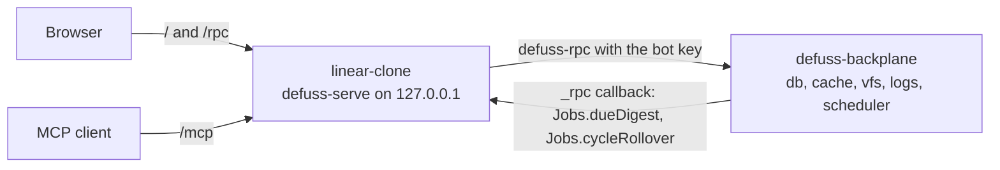

# linear-clone architecture

linear-clone shows how an app service uses every [defuss-backplane](https://github.com/kyr0/defuss-backplane) service without a database of its own. This page explains the parts, why each beats the obvious alternative, and how to operate the service.

## Overview

The app is one Bun process. The browser and MCP clients call it; it calls the backplane; the backplane's scheduler calls it back.

| Module | Job |
| --- | --- |
| `src/core` | Pure rules: validation, patches, ordering, IDs, cycle statistics, the due digest and the rollover plan. No I/O, so tests feed it plain values. |
| `src/server/workspace.ts` | The only module that talks to the backplane. It maps the workspace onto buckets, the cache, files, logs and the scheduler queue. |
| `src/server/api.ts` | The RPC namespaces, and the translation of failures into coded faults. |
| `src/server/jobs.ts` | The two scheduled jobs, their schedules and the bot-key guard. |
| `src/server/server.ts`, `cli.ts` | The listener, uploads and downloads, MCP, startup checks and shutdown. |
| `src/web` | The frontend: a store, actions, and views as JSX components. |

## Why the backplane holds the state

VERIFIED: the app keeps no state in its process or on its disk (tests/workspace.test.ts runs it against a throwaway daemon). A restart or a move to another host loses nothing, and agents reach the same data over the backplane's own MCP tools. The alternative, a SQLite file next to the app, would need its own backup, migrations and an MCP surface for agents.

Each workspace is one backplane tenant. Issues carry revisions: `Issues.update(id, patch, ifRevision)` fails with `REVISION_CONFLICT` when someone changed the issue since that revision, so two browser tabs cannot overwrite each other unseen. VERIFIED: concurrent creates each get their own number, because the team's counter is reserved with a revision check and retried (tests/workspace.test.ts).

Cycle statistics are cached for 5 minutes and dropped when an issue of that cycle changes. The browser computes the same numbers with the same core function, so the cycle page updates without a round trip.

## Why the backplane schedules the jobs

The app runs no timer. At startup it creates or updates two schedules in the backplane's scheduler, whose RPC callbacks call `Jobs.dueDigest` and `Jobs.cycleRollover` on the app's own URL with the bot key. VERIFIED: with `DIGEST_CRON` set to every second, the real backplane delivers a callback and an inbox item appears (tests/jobs.test.ts). A timer in the app would miss runs while it is down and keep no history; the backplane's schedules retry and record each run. VERIFIED: the backplane keeps the ID of a removed or terminated schedule reserved, and before the fix the next start failed with "Schedule ID is reserved" (the deep suite found it). Now a job without a live schedule gets a successor under a fresh ID, which carries the job's name as `ref`, and later starts find it by that ref. Why a ref rather than a stored ID: the app keeps no state of its own, and an agent sees which job a schedule belongs to (tests/jobs.test.ts).

- The due digest adds an inbox item for the assignee of each open issue that is due today or overdue, once per issue and day.
- The rollover closes a cycle that ended, opens the next one and moves its unfinished issues there, at most 52 cycles per call.

## Why the frontend morphs

The frontend starts from the [defuss-shadcn](https://github.com/kyr0/defuss-shadcn) issue tracker scaffold: its markup, styles and component bundle. The scaffold's rows, cards, issue page, notes and table rows became JSX components compiled for [defuss-morph](https://github.com/kyr0/defuss-morph). Each rendered region is a `reactive()` binding to one store, keyed by issue ID. After an action, every region renders again, and [defuss-morph](https://github.com/kyr0/defuss-morph) changes only the nodes that differ.

Rebuilding the regions with `innerHTML` would be the simpler alternative. It would drop focus, typed text and listeners on every change. VERIFIED: a comment typed on an issue page survives a priority change of that issue, which re-renders the page (scripts/e2e.ts). Within one region, keyed rows keep their nodes; a row whose status changes leaves its group's region and is created in the other. The shell outside the regions changes only through [defuss-query](https://github.com/kyr0/defuss-query). The gate rule `linear-clone.morph-rendering` rejects hand-written DOM writes in `src/web`.

Writes from one tab run one after another. VERIFIED: before that, three quick select changes on one issue page made the second fail with `REVISION_CONFLICT` against the first.

Lucide icons are imported one by one and rendered as SVG by the same components. VERIFIED: the frontend bundle is 127 KB minified, against 553 KB with every Lucide icon.

## Security

- Both listeners stay on 127.0.0.1, and [defuss-serve](https://github.com/kyr0/defuss-serve) rejects a foreign `Host` header on every route.
- There is no user authentication yet. Anyone who can reach the port acts as `VIEWER`. Put an authenticating proxy in front before you expose it.
- The bot key never reaches the browser. `Jobs` checks it in constant time and answers 403 without it, and MCP does not list `Jobs`.
- Uploads are checked before the first byte arrives: the issue must exist, the file name must be valid and the announced size must be at most 25 MiB, else the server answers 403.
- VERIFIED: MCP answers 403 to every request with an `Origin` header ([defuss-mcp](https://github.com/kyr0/defuss-mcp)'s check with `allowedOrigins: []`), so a web page cannot drive the tools through a visitor's browser.

## Privacy

The workspace holds names of people, issue texts, comments and attachments, all in the backplane's data root. The audit log records who created, changed, moved or deleted an issue, with the issue ID, the changed field names and, for a move, the old and new status; it records no other field values. The app's log lines carry method names and error messages, not request bodies, and never the bot key. Deleting a workspace means deleting its backplane tenant.

## Operations

| Task | Command |
| --- | --- |
| Start detached, built from source | `make start` writes `tmp/linear-clone.pid`, appends to `var/log/linear-clone.stdout` and `.stderr`, and prints the state as JSON once the app logs `listening` or exits. |
| Check | `make status` prints the state, pid and URL as JSON and exits 1 only for a stale pid. `make health` asks `/readyz`, which passes only while the backplane is ready, and `make healthz` asks `/livez`. |
| Read the log | `make log` merges stdout and stderr by time, one JSON object per line; or the backplane's app log of `linear-clone`. |
| Metrics | `make metrics` prints the backplane's call counts and durations for this app. |
| Stop | `make stop` sends `SIGTERM` and kills after 5 seconds. |
| Inspect the data as an agent | `make mcp-config` writes the app's MCP entry into `.mcp.json` here and at the repository root. |

The probes `/livez` and `/healthz` answer while the app serves; `/readyz` and `/health` also ask the backplane's `/readyz` and answer 503 without it. Why a readiness that asks the backplane: no call can succeed without it, so a supervisor should route nothing to the app then. They report pass or fail only, like the backplane's. VERIFIED: tests/api.test.ts sees 503 after its daemon stopped, and the deep suite asks all four. VERIFIED: `make start`, `status`, `log`, `metrics` and `stop` work against a running backplane, and the lifecycle verbs' JSON is tested with a real process in the repository's tests/service.test.ts, and a restart on another port updates the schedules' callback URL (tests/jobs.test.ts). Each log line starts with an ISO-8601 UTC timestamp and its level. VERIFIED: [defuss-mcp](https://github.com/kyr0/defuss-mcp) prints one notice on stderr at startup, because the MCP endpoint answers in JSON mode.

The e2e connects its MCP client from the file `make mcp-config` writes for the built app. It calls every MCP tool and its RPC function: reads on the same state, writes on twin issues with IDs, titles and times masked, and every call states its expected outcome, a value or an HTTP status. Why stated outcomes: two equal failures would otherwise pass as a match. VERIFIED: that happened while the check was written, and the stated outcomes then exposed a 500 for a non-string cycle ID, now a 400. VERIFIED: with titles left unmasked, the check fails at `Issues.create`. Frontend coverage comes from Chromium's V8 coverage of the built `main.js`, mapped through its source map; the coverage of each document is kept before the journey reloads the page.

The deep suite (`scripts/deep.ts`) runs one scenario per transport through a call function, so RPC and MCP pass the same assertions. Why one scenario instead of the twin comparison above: a twin comparison proves only that both transports agree, and two equally wrong answers pass. The deep suite states what each call must do. It runs on an instance of its own in `_e2e_test_linear-clone`, so `make e2e-live` can run beside the app `make start` runs without touching its workspace, and it starts with both jobs every second so the backplane delivers them during the run. VERIFIED: two consecutive runs against one backplane passed all 27 steps, and the second one passed only after the schedule fix above.

To back up, back up the backplane's data root; the app has nothing else.
