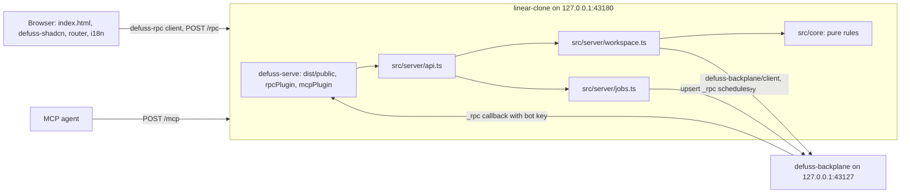

# Plan: the linear-clone example app

Status: in progress. M0 to M5 are done; M6 is built and waits for its proof, M7.

Tick a milestone `- [x]` when its proof passes, then run `verify` on its scope.

## Goal

`examples/linear-clone` is an issue tracker in the style of Linear. It is a Bun service of its own and a clean VAE project. Its backend serves the frontend, a defuss-rpc API and a defuss-mcp endpoint through defuss-serve, as the backplane does. The frontend is the defuss-shadcn issue tracker scaffold, adapted from a clickdummy to live data. It routes with defuss-dom-router, translates with defuss-i18n and calls its backend with the defuss-rpc client. The backend keeps no state of its own. It stores everything in the backplane under the app name `linear-clone` and uses all five backplane services. There is no user authentication yet.

## What the plan stands on

- VERIFIED: the scaffold is `src/documentation/pages/application/scaffold-issue-tracker.mdx` in defuss-shadcn, 7304 lines. Lines 21 to 1421 hold its own CSS, 1422 to 6725 the markup, 6726 to 7235 a classic script and 7236 to 7285 a module script.
- VERIFIED by parsing the markup with linkedom: it pre-renders 15 issues, ENG-128 to ENG-142, each as a list row, a board card and its own issue page. The views are `issues` (list, board and data grid), `my-issues`, `inbox`, `cycles` and `projects`. There is a context menu `#pm-ctx`, a command palette `#pm-cmd` and a create dialog `#pm-create`. The templates `pm-tpl-row`, `pm-tpl-card` and `pm-tpl-issue` stamp new issues. The i18n catalog is a set of `<template data-i18n-for>` elements for English and German.
- VERIFIED: the module script routes in hash mode with defuss-dom-router 0.1.1 (`#/`, `#/my-issues`, `#/inbox`, `#/cycles`, `#/projects`, `#/issues/:id`, `*`). It translates the shell with defuss-i18n 0.2.0 (`createI18n`, `createDomI18n(df$)`). It takes `df$` from the component bundle.
- VERIFIED from the npm tarball: defuss-shadcn 0.10.0 ships `dist/apps/issue-tracker/issue-tracker.min.{css,js}`, the per-component files under `dist/components` and the scaffold `.mdx`. VERIFIED from `scripts/lib/apps.ts` in defuss-shadcn: an app bundle is the core plus exactly the components the app uses. It holds neither the scaffold's `.pm` styles nor the router or i18n.
- VERIFIED: the scaffold's script loads one avatar from `https://github.com/kyr0.png` and the others from the documentation site's `images/avatars/`. defuss-shadcn's integration guide, `dist/SKILL.md`, loads Lucide from unpkg. The npm package ships no avatar images.
- VERIFIED from defuss-dom-router's README: `prepare({ to, signal })` may be asynchronous and runs before history changes. An issue page can therefore load its issue before it shows.
- VERIFIED from defuss-rpc's README: a server guard gets `(namespace, method, args, request)` and only an explicit `false` answers 403. A function gets only its arguments. `addStreamingUploadHandler` and `addStreamingDownloadHandler` stream files.
- VERIFIED by `tests/client.test.ts` of the backplane: `defuss-backplane/client` runs each connection on a defuss-rpc 4.3.0 client context, so an application's `addHook()` and `setHeaders()` do not reach backplane calls, and it refuses redirects that would carry the bot key elsewhere.
- VERIFIED: defuss-mcp 0.6.2 exports `defuss-mcp/rpc`. Its README says the `exposeRpc` bridge re-enters the RPC dispatcher, so RPC guards also cover MCP calls.
- VERIFIED: npm has defuss-backplane 0.2.0 only. The `_rpc` callbacks exist in the repo's unreleased 0.3.0.
- VERIFIED by probe on Bun 1.4.5, the `mise.toml` pin:
  - A `file:` directory dependency installs as hard links, one per file. An edit in place shows through. A recreated file, as `pkgroll --clean-dist` writes, and a new file show only after the next `bun install --frozen-lockfile`, which re-links them. pkgroll names a chunk by hash (`dist/config-DCePkTcq.js`).
  - `file:../..` links the whole repository, 42 MB with `var/`, `tmp/`, `node_modules/` and the example itself.
  - A tarball dependency kept its first content after a repack, under a frozen install and after deleting `node_modules`.
- VERIFIED by probe on Bun 1.4.5: `coverageThreshold = 0.6` under `[test]` in `bunfig.toml` makes `bun test --coverage` exit 1 below the floor. `bun test` without test files exits 1.
- VERIFIED from `vae.py:51`: `--repo` resolves to the git toplevel, so the whole repository has one gate. A `command` rule runs on every gate. A `glob` scope applies only to file rules (`vae_verify.py:run_custom_rule`).
- VERIFIED with `git check-ignore`: the root `.gitignore` covers `node_modules`, `dist` and `.env` everywhere. It covers `var/`, `tmp/`, `output/` and `input/` only at the root.
- VERIFIED: defuss-scheduler drives its browsers with `playwright-core` 1.65.1 from `scripts/e2e.ts`. The local Playwright cache holds the builds that version lists: chromium-1255, firefox-1572 and webkit-2388.

## Decisions

1. **Rendering.** The frontend stays framework-free, as defuss-shadcn is. TypeScript modules stamp the scaffold's own `<template>`s from data. One template renders the issue page of the current route, in place of 16 pre-rendered pages. Alternative: the defuss JSX framework. Nobody asked for it, and it would mean rewriting markup that already works.
2. **Backplane access.** The backend calls the backplane only through `defuss-backplane/client`, which is the defuss-rpc protocol with a per-connection bot key. It binds the app, tenant and bucket to each call, turns failures into `BackplaneError` codes and streams files over the backplane's VFS routes, none of which a plain client offers. The browser uses the stock `getRpcClient` against its own origin, which needs no key.
3. **Backplane version.** The callbacks are not on npm, so the example depends on `"defuss-backplane": "file:./deps/defuss-backplane"`. `make setup` runs the root's `make pack`, extracts the tarball into the gitignored `deps/` and runs `bun install --frozen-lockfile`. The example thus installs only the published files, as an npm consumer would, and the install re-links them after each pack. Once 0.3.0 is on npm, the example switches to the exact npm version.
4. **Gate.** The repository has one gate, so the root `.vae/VERIFY.py` gets the `command` rule `linear-clone.verify` with a 900-second timeout. It runs `make -C examples/linear-clone setup lint test coverage` and becomes `setup verify` in M7, when the example's e2e exists. A rule that ran `verify` from M0 on would fail every root gate until then. The alternative is to make the root verbs call the example's. That mixes two projects' verbs. HYPOTHESIS: the rule adds 2 to 4 minutes per root gate; falsifier: time the first run.
5. **Coverage.** The example's `bunfig.toml` sets the 60 % floor, so its own `make test` fails closed. Coverage counts the backend and the pure core. The browser glue is proven by Playwright and not counted. ARCH.md states this.
6. **Browsers.** `node scripts/e2e.ts` drives `playwright-core` 1.65.1, the same pin as defuss-scheduler. The full journey runs on Chromium. Firefox and WebKit open every route, check the console for errors and create one issue.
7. **Workspace and viewer.** The backplane tenant is the workspace, `WORKSPACE` (default `vector`). Without auth, `VIEWER` names the person whom "My issues", comments and the activity feed refer to. When auth comes, the session replaces `VIEWER`.
8. **Jobs are idempotent by construction.** A digest notification has the ID `digest:<date>:<issue>`, and a rollover acts on one cycle ID, so a repeated delivery inserts nothing new. Deduplicating by `X-Backplane-Run` would need the request in the function, which only guards see.
9. **Callback guard.** A defuss-rpc guard rejects every `Jobs.*` call whose bearer token differs from the backplane key, compared in constant time. The MCP bridge leaves `Jobs` out.
10. **Schedule upsert.** The callback URL contains the app's port. At startup the app creates each schedule, and if it already exists, updates the schedule whose cron, time zone or payload differ.
11. **MCP.** `exposeRpc(registry, ({ request }) => rpc.fetch(request), { codec: "json", include })` exposes the app namespaces and leaves `Jobs` out. The bridge takes any route of the form `({ request }) => Promise<Response>`, and a defuss-rpc 4.3.0 instance's `fetch` fits it without an adapter.
    - VERIFIED by probe on 2026-11-25, with defuss-mcp 0.6.2, defuss-rpc 4.3.0 and defuss-serve 0.4.0 driven by the official MCP client. Only the included tool was listed, a call returned its result as JSON, and the RPC guard ran with the MCP request's headers.
    - The app's schema is open, so the bridge needs no `discoveryHeaders`, which defuss-mcp 0.6.2 offers for a guarded schema.
12. **No third-party requests.** Lucide comes from npm and is bundled. Avatars show initials. The seed keeps the scaffold's names and content.
13. **Seed.** On first start, an empty workspace gets `input/seed.json`: the scaffold's 15 issues with their descriptions, sub-issues, comments and activity, 6 people, the ENG team, 5 projects, Cycle 24 and 6 inbox items. A one-off extraction parsed the scaffold markup; the file is committed with `!input/seed.json`. The seed is written for 2026-10-03, the day the scaffold's cycle view shows, and seeding moves every date by the days since then, so the demo cycle is running. A workspace that has a team is not seeded again, so a deleted demo issue stays deleted. The team goes in last and inserts that fail with `ALREADY_EXISTS` are skipped, so a start that stopped halfway completes the seed.

### How each backplane service is used

| Service | Use | Why this service |
| --- | --- | --- |
| db | Buckets `people`, `teams`, `issues`, `comments`, `events`, `projects`, `cycles` and `notifications`. Edits carry `ifRevision`. The team document holds the next issue number, advanced with a revision check and a retry. | Documents with queries, and revisions for concurrent tabs |
| cache | `stats:<cycle>`: the cycle's counts, per-assignee progress and burn-up series, with a 5-minute TTL. Every issue write deletes it. | Derived data that is safe to lose. HYPOTHESIS: the cache saves a query over every issue of the cycle per view; falsifier: `make bench` with and without it |
| vfs | Bucket `attachments`, key `<issue>/<file>`. The browser uploads with defuss-rpc's streaming upload, and the backend streams on to `vfs.upload`. Downloads stream back the same way. | Large binary objects |
| logs | The service's own lines go to the `linear-clone` app log through a defuss-logs logger. Workspace audit events, such as an issue created, moved or deleted, go to the tenant log. | One log store that agents can read |
| scheduler | `due-digest` (`0 9 * * *`): inbox items for issues due today or overdue. `cycle-rollover` (`0 0 * * 1`): close the ended cycle, carry its open issues over and open the next one. Both use handler `_rpc` with `Jobs.dueDigest` and `Jobs.cycleRollover`. | The app runs no cron of its own |

## Architecture

### Module owners and contracts

| Concern | Owner | Contract and its check |
| --- | --- | --- |
| Statuses, priorities, labels, draft and patch validation, ID format, cycle statistics, digest and rollover selection | `src/core/*.ts`, pure | Exported types and functions; unit tests with real values |
| Configuration | `src/server/config.ts` | `loadConfig(env)` validates once and fails fast; tests per invalid key; `.env.example` lists every key |
| Backplane connection, buckets, revisions, seed | `src/server/workspace.ts` | The only module that imports `defuss-backplane/client`; integration tests against a real daemon |
| Logging | `src/server/log.ts` | ISO-8601 line plus a defuss-logs record; a test reads the records back through the backplane |
| Public RPC API | `src/server/api.ts` | `type Api` is imported by the frontend as a type only; `tsc` checks both sides |
| Schedules and callbacks | `src/server/jobs.ts` | Upsert at startup, the `Jobs` guard, idempotent handlers; integration tests |
| Listener and shutdown | `src/server/server.ts`, `src/server/cli.ts` | `startServer(config)` returns `{ url, close }`; a SIGTERM test checks exit code 0 |
| Client state | `src/web/store.ts` | One store of issues by ID; views subscribe and never keep copies |
| Views | `src/web/views/*.ts` | Each renders from the store and changes it only through `src/web/actions.ts`, which calls the API |

## Milestones

- [x] **M0 Project skeleton.**
  - Run `bun init` in `examples/linear-clone`.
  - `package.json`: `private`, `type: module`, `packageManager: bun@1.4.5`, the root's `mise.toml` pin, description, MIT, author, exact pins. The backplane already runs defuss-serve 0.4.0, defuss-rpc 4.3.0 and defuss-mcp 0.6.2, and the app pins the same.
  - Add `tsconfig.json`, `bunfig.toml` with the coverage floor, a `.gitignore` for `var/ tmp/ output/ input/* deps/` and `!input/seed.json`, `.env.example` and a `Makefile` with every VAE verb. `metrics`, `bench` and `e2e` exit 2 as UNKNOWN until their milestones.
  - `src/server/config.ts`: `loadConfig(env)` for the keys of `.env.example`, `PORT`, `BACKPLANE_PORT`, `BACKPLANE_API_KEY`, `WORKSPACE` and `VIEWER`, with `tests/config.test.ts`. Lint needs a source file, and `.env.example` must match the keys the code reads. The default `VIEWER` is `aron`: VERIFIED from the scaffold script, "My issues" lists the rows assigned to `aron`.
  - Add the root rule from decision 4.
  - Repeat the two Bun probes above under the pinned 1.4.5.
  - VERIFIED from `vae_repo.py:235`: the package check requires pkgroll only of a package that is not private and declares `exports`, `main` or `module`. The private app needs none.
  - Proof: `make setup lint test coverage` passes, and the root gate runs the new rule.
- [x] **M1 Pure core.**
  - `src/core/issue.ts`: enums, rank order, `validateDraft` and `validatePatch` with length bounds.
  - `src/core/ids.ts`, `src/core/stats.ts` (scope, started, done, per assignee, burn-up), `src/core/digest.ts` (due on a date in a time zone), `src/core/rollover.ts`, and `src/core/dates.ts` for the calendar dates the last three share.
  - The burn-up counts an issue in the scope from the day it was created and as done from its `completedAt`, which `applyPatch` sets on the move to `done` and clears on the move back.
  - Proof: `tests/core.test.ts`, with each rule's main error path.
  - Docs: why ranks and statistics live in the core. The server and the browser show the same numbers.
- [x] **M2 Backplane workspace.**
  - `src/server/workspace.ts`: one `connectBackplane({ app: "linear-clone", port, apiKey })`. It provides repositories per bucket, `nextIssueId` with a revision retry, `seed(input/seed.json)`, the stats cache with invalidation, and attachments over `vfs.upload` and `vfs.download`.
  - `src/server/log.ts`. VERIFIED by probe: defuss-logs formats extra `write` arguments into the message, so fields go into a child logger's context.
  - `src/core/model.ts` holds the document types and `src/core/seed.ts` the seed shift; `defuss-logs` 0.3.0 is a dependency, as the backplane README requires for `createLogger`.
  - `tests/helpers/daemon.ts` starts the real `defuss-backplane` binary from the `file:` dependency, with a temporary data directory, a free port and a random key, and waits for `/readyz`.
  - Proof: integration tests for CRUD; a stale revision returns `REVISION_CONFLICT`; 20 concurrent creates get 20 distinct IDs; a second seed is a no-op; a write clears the stats cache; an attachment round-trips byte for byte; log records can be read back from the app log and the tenant log.
- [x] **M3 Service.**
  - `src/server/api.ts` with namespaces `Workspace` (bootstrap: people, teams, projects, cycles, labels, viewer), `Issues` (list with paging over the 1000-row query bound, get, create, update, remove, comment, subtasks, attachments), `Inbox` (list, markRead), `Cycles` (current with stats) and `Jobs`.
  - Upload and download handlers named `attachment`, with a size limit guard.
  - `src/server/server.ts`: defuss-serve with `publicDir: dist/public`, `rpcPlugin(rpc)`, `mcpPlugin`, host `127.0.0.1`, SIGTERM handling.
  - `src/server/cli.ts`: checks backplane readiness at startup and fails fast with a clear message. It reads `dist/public` and `input/seed.json` from the working directory, as Bun reads `.env`.
  - VERIFIED by probe with defuss-rpc 4.3.0: every thrown error reaches the client as HTTP 500 with `{"error":"Error calling function <m>: <message>"}`. `src/core/faults.ts` therefore puts a code in the message (`NOT_FOUND: …`, `INVALID_INPUT(title): …`), the server rewrites the status from it (400, 404, 409, 413, 503), and the browser reads it back. The MCP bridge reports a failed call as "RPC call rejected (HTTP 404)", so agents see the status.
  - VERIFIED by probe: an upload handler's metadata holds the upload ID and file name but no headers. An upload therefore names its issue in its ID, `<issue>.<uuid>`, and downloads use the ID `<issue>/<name>`.
  - VERIFIED: a streaming upload handler that threw without reading left defuss-rpc 4.3.0's temp file open, and Bun failed with "A FileHandle object was closed during garbage collection". The guard now refuses a missing issue, a bad name or an announced size above 25 MiB with 403 before the bytes arrive. The root cause is fixed in defuss-rpc 4.3.1 (built locally, not yet on npm); the app moves to it once it is published.
  - `TIME_ZONE` (default `UTC`) joins the configuration: today, due dates and cycle days follow its calendar.
  - Proof: tests through the real defuss-rpc client and the official MCP client. Every API method is called once, with its main error. `Jobs` is absent from MCP. SIGTERM exits with 0. Each invalid configuration value fails startup.
- [x] **M4 Schedules.**
  - `DIGEST_CRON` (default `0 9 * * *`) and `ROLLOVER_CRON` (default `0 0 * * 1`) join the configuration and run in `TIME_ZONE`. Changes the jobs make carry the actor `system`. The rollover carries the open issues before it closes the cycle, so a call that stops halfway is completed by the next one.
  - `src/server/jobs.ts`: upsert both schedules, the guard, `dueDigest` and `cycleRollover` on top of the core.
  - Proof:
    - a `Jobs` call without the key answers 403, and with it runs;
    - a repeated call creates nothing new;
    - a restart on another port updates the payload URL;
    - with `DIGEST_CRON` set to every second, the real backplane delivers a callback and an inbox item appears.
- [x] **M5 Frontend shell.**
  - A one-off extraction took the shell, the templates and the styles from defuss-shadcn 0.10.1's full-screen page (`docs/application/app-issue-tracker.html`), without the 15 pre-rendered issues, pages, notes, people, projects and other cycles. The inbox note, the assignee row and the project row became templates (`pm-tpl-note`, `pm-tpl-person`, `pm-tpl-project`), avatars show initials, and the issue template gained sub-issues and attachments.
  - VERIFIED: the app bundle has no `file-input`; the build copies `dist/components/file-input/file-input.min.css`, and the plain file input needs no script.
  - `scripts/e2e.ts` runs with Node.js: it deploys `dist/` and the seed into a temporary directory, starts the real backplane and `bun dist/server.js` there, and opens every route in Chromium, Firefox and WebKit without console errors.
  - `src/web/index.html`: the scaffold shell and templates without the demo issues.
  - `src/web/tracker.css`: the scaffold's styles.
  - `src/web/main.ts`: i18n, router, RPC client and Lucide.
  - `scripts/build.ts`: `Bun.build` for the browser, then copies the defuss-shadcn app bundle into `dist/public`.
  - UNKNOWN: whether the app bundle contains `file-input` for attachments; probe with grep. If not, add that component's CSS and JS from `dist/components`.
  - Proof: Chromium opens every route against a seeded workspace without console errors.
- [ ] **M6 Frontend features.**
  - `src/web/store.ts`, `src/web/actions.ts` and the views:
    - list, board with drag and drop, and data grid;
    - scope chips and the filter;
    - the issue page with status, priority and assignee selects, subtasks, comments, activity and attachments;
    - the create dialog with `C`;
    - the context menu;
    - the palette with `⌘K`, and `J` and `K` to move;
    - inbox, cycles with the burn-up chart, projects;
    - the language and theme switches, which persist through `df$.store.persisted`.
  - A `REVISION_CONFLICT` shows a toast and reloads the issue.
  - The issue model gained `startedAt`, which the burn-up's started series needs, and the seed shifts instants by the exact time since noon of its day, so the scaffold's "12m ago" stays 12 minutes.
  - Proof: M7.
- [ ] **M7 Browser end-to-end.**
  - `scripts/e2e.ts` builds the artifact and starts the real backplane and the built server as child processes on temporary data.
  - On Chromium it covers every route, every view switch, drag and drop, the context menu, create, every issue-page edit, an attachment upload and download, the palette, the shortcuts, inbox, the cycle numbers after a status change, projects, and the language switch after a reload. It reloads after each write to prove persistence.
  - On Firefox and WebKit it runs the smoke from decision 6.
  - It writes `output/e2e.json`.
  - Proof: `make e2e` exits 0, and the file lists every route and browser.
- [ ] **M8 Operations and docs.**
  - `make start` builds and runs detached, with `tmp/linear-clone.pid` and `var/log/linear-clone.std{out,err}`, and fails if the backplane is not ready. Also `stop`, `status`, `log`, and `metrics`, which reads the backplane's `/metrics` lines with `app="linear-clone"`.
  - `bench`: the `Issues.list` round trip over 1000 issues, written to `output/bench.json`.
  - `README.md`: run, configure, API, MCP and the service mapping. `ARCH.md`: why and how, data model, schedules, security, privacy and operations. A link from the root README.
  - Proof: `vae.py prose --fix` finds nothing; `make start status log stop` works against a running backplane.
- [ ] **M9 Gate.** Proof: `make -C examples/linear-clone verify` and the root gate pass.

M1 to M4 and M5 to M6 touch disjoint paths, and `type Api` from M3 is their contract. A parallel frontend unit is possible after M3. I recommend staying sequential. HYPOTHESIS: building the views changes the API; falsifier: the diff of `src/server/api.ts` during M5 and M6.

## Security and privacy

- Both listeners stay on 127.0.0.1.
- Without auth, anyone on the host can use the tracker. This is acceptable for the example and is stated in the README.
- VERIFIED from defuss-serve's README: `rpcPlugin` requires `application/json`. Another origin therefore cannot send a call without a CORS preflight, and the app answers none.
- VERIFIED by `tests/o11y.test.ts:34` of the backplane: defuss-serve answers 403 to a foreign Host header. A DNS-rebinding page sends its own host name, so the check refuses it.
- The bot key stays in the backend. The browser never sees it.
- Static files are public, so `dist/public` holds only built assets.

## Out of scope

User auth and sessions, real-time updates across tabs, multiple teams in one view, issue search on the server, and publishing the example to npm.
