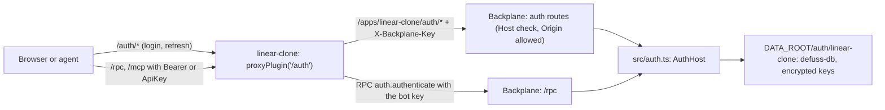

# defuss-auth as a backplane service, with user and API key auth in linear-clone

Goal: the backplane hosts one [defuss-auth](https://github.com/kyr0/defuss-auth) authority per app. An app forwards its browser's `/auth/*` routes to the backplane and asks the backplane, on every API call, who sent it. linear-clone replaces its fixed `VIEWER` with the signed-in person, and agents call it with API keys.

Milestones tick `- [x]` when their proof passes; then run `verify` on that milestone's scope.

## Evidence

- VERIFIED: the integration contract is defuss-auth `docs/HOSTING.md` and `src/host.ts` at 3a3897e, written by the defuss-auth agent for this work.
  - `createAuthHost({ directory, masterKey, credential })` opens one authority per app in `<directory>/<app>/`.
  - `host.plugin()` serves `/apps/<app>/<route>` and checks the proxy's credential field in constant time.
  - `host.authenticate(app, authorization, { tenantId })` checks a JWT or API key against live state and returns plain data.
  - `host.maintain()` rotates aged signing keys; `host.closeAll()` closes every app.
- VERIFIED: defuss-auth 0.2.0 is not on npm (`npm view defuss-auth` fails). Its peers are `defuss-db` and `defuss-storage` 0.4.1, both optional. The defuss-auth agent reports that its full gate passed with defuss-db 3.3.0 on Node.js 26.13.1 and Bun 1.4.4, and that its working tree now declares `"defuss-db": "3.2.0 || 3.3.0"`, not yet committed or published. The backplane bundles `defuss-db` 3.3.0 as a devDependency. The `.vae/VERIFY.py` rule `backplane.registry-deps` forbids `file:`, `link:` and `portal:` dependencies.
- VERIFIED: in `src/server.ts`, every route except the probes passes `local`, which refuses any `Origin` field and a foreign `Host`, and `guarded`, which wants the bot key in `Authorization`. Cookie-mode auth writes need `Origin` and carry the user's credential in `Authorization`, so the auth routes need a wrapper of their own.
- VERIFIED: defuss-serve 0.4.0, the backplane's pin, already has `trustedProxies` (its dist types). linear-clone needs defuss-serve 0.5.0 for `proxyPlugin`; 0.5.0 is on npm.
- VERIFIED: defuss-auth `src/server.ts:privateDirectory` refuses a storage directory that differs from its real path, is not owner-only or belongs to another user. On macOS a `mkdtemp(tmpdir())` path differs from its real path (probe: `realpathSync(d) === d` is false), so the test daemons would fail unless the daemon passes `realpath(dataRoot())`.
- VERIFIED: browser probe on 2026-11-26 with linear-clone's playwright-core. WebKit drops a `Secure` cookie on both `http://127.0.0.1` and `http://localhost`, while Chromium and Firefox keep it on both. Caddy is not installed.
- VERIFIED: in linear-clone, `src/server/api.ts:createApi` takes one fixed `viewer` (config `VIEWER`) for every write. Handlers never see the request; only defuss-rpc hooks do (defuss-rpc `src/server.ts:227`). MCP tool calls forward the caller's headers to the RPC route (defuss-mcp 0.6.2 `dist/rpc.mjs:74`). Attachment downloads use `rpc.downloadAsBlob`, which takes headers per call. `Person` is `{ id, name }`.
- VERIFIED: backplane app names allow any Unicode except a leading `_`, and tenant names have 1 to 48 UTF-8 bytes (`src/scope.ts`). defuss-auth app names are lowercase `[a-z0-9][a-z0-9_-]{0,63}`, and its tenant IDs are `[A-Za-z0-9_-]{1,128}`.

## Design

1. One `AuthHost` in the daemon, owned by a new module `src/auth.ts`. Its directory is `realpath(dataRoot())/auth`. App directories end in `-` and 8 hex digits, so `auth` cannot collide with an app, `scheduler` or `_backplane`.
2. Names: auth serves only app names that fit defuss-auth's rule, and tenant names that match `[A-Za-z0-9_-]{1,48}`. Others get `INVALID_ARGUMENT`. Why not a mapping: a hashed tenant ID would hide the tenant in tokens and logs. Both known apps already fit: `linear-clone` with tenant `vector`, and `deep-e2e` with tenant `_e2e_test_backplane`.
3. Apps register over RPC: `auth.configure({ app }, { origin, mode })` at the app's startup. The daemon keeps the registrations in `<auth>/apps.json`; the dot means no app can have that name. At startup it reopens every registered app, so a proxied login works right after a daemon restart. The daemon sets the rest itself:
   - issuer = `origin`, audience = the app's name, `allowedOrigins` = `[origin]`;
   - `authorizeAdmin` = `tenantAdmin("admin")`;
   - no email delivery.
   Why not operator configuration: today an app joins the backplane by using its name, without a daemon restart, and a per-app list in `.env` would end that.
4. Routes: `host.plugin()` at `/apps`, behind a wrapper that checks `Host` but allows `Origin` and wants no bot key, because the host checks `X-Backplane-Key` itself. `createServer` gets `trustedProxies: ["127.0.0.1"]`, so per-client login throttles work.
5. RPC module `auth`, with the bot key like every module, scoped by `{ app, tenant }`. It holds only what linear-clone and the e2e use:
   - `configure` and `authenticate`;
   - `addMember`: creates the user if the email is unknown and the tenant if it is missing, then sets the claims;
   - `removeMember`, `listMembers` and `setPassword`;
   - `createApiKey`: a service account in the tenant plus its key, whose secret the call returns once;
   - `listApiKeys` and `revokeApiKey`.
   Each returns plain JSON, never a `Principal`.
6. Configuration: `BACKPLANE_AUTH_MASTER_KEY`, base64url of 32 bytes, optional.
   - Unset: the daemon starts, `/apps` answers 404, and `auth.*` answers `UNAVAILABLE` naming the missing key.
   - Malformed: startup fails.
   - `make env` writes it into a new `.env`, and the README tells existing installs to add it.
   Why optional: existing `.env` files have no such key, and `make env` never overwrites a file.
7. Maintenance: an unref'd hourly timer calls `host.maintain()`, and an app that fails logs one `WARN` line. Why not a scheduler schedule: the scheduler runs apps' jobs, while this timer belongs to the daemon and ends with it.
8. linear-clone asks the backplane on every call instead of checking JWTs against the JWKS. A revocation or grant change then acts on the next call, and API keys are opaque, so no local check could verify them.
9. Persons: linear-clone's `Person` gains an optional `subject`, the auth subject ID. A request acts as the person whose `subject` matches; a subject without a person gets 403. Each service account gets a person of its own, named after its key.
10. Request identity: linear-clone's RPC route authenticates first, then runs `rpc.fetch` inside an `AsyncLocalStorage` that holds the person, and handlers call `viewer()`. The `Jobs` namespace keeps its bot-key guard. A bot-key request carries no person, so every other namespace refuses it.
11. Bot users, the human's idea of 2026-11-26: the backplane keeps its own users as if it were an app, in the reserved `_backplane` app, which already holds the daemon's log in `DATA_ROOT/_backplane`. They never collide with app users, because every app has its own authority.
    - Storage: `DATA_ROOT/_backplane/auth`, opened with `createAuth` directly and not through the host. VERIFIED: defuss-auth host names must start with a letter or digit, so `_backplane` cannot be a host app, and no host app can claim that directory. Its key is derived from the master key with HKDF-SHA-256 under a salt of its own, `defuss-backplane/bot-auth/v1`, because the host's derivation is no public contract. The host's `maintain` and `closeAll` do not cover it, so the daemon's timer and `close` call it too.
    - A bot user is a service account in tenant `_backplane` with an API key. It sends `Authorization: ApiKey …`, and `guarded` accepts either that key or the `API_KEY` from `.env`. `API_KEY` stays as the root key, so existing apps keep working and the first bots can be created.
    - Each bot's claims name the apps it may use (`app:linear-clone`) or `admin`. One check per entry point refuses a scope outside those claims: an RPC guard hook on the first argument, the MCP tools, and the transfer routes. A leaked app key then reaches one app instead of all of them.
    - An app's proxy sends its own bot key in `X-Backplane-Key`. The auth route wrapper checks the key, then replaces it with a per-start internal secret, the only credential the host knows. The host thus keeps trusting `X-Forwarded-For` only from a verified proxy. The defuss-auth agent confirmed this keeps its rate-key trust under these conditions, which A8 tests:
      - the key's claim `app:<name>` equals the `/apps/<name>/` path segment, so app X's key cannot drive app Y's routes or choose Y's rate keys;
      - the wrapper sets the header, never appends it, and runs before the body is read;
      - the secret is 32 random bytes in base64url, and `trustedProxies` stays loopback only;
      - the rebuilt request keeps the streamed body and `request.signal`, as defuss-auth `src/host.ts:fetch` does.
    - API keys expire after 90 days by default and after 365 days at most, so operations include `bots.rotate`, and the README says when to run it. The store keeps only a digest, so the daemon can never send a bot key back to its app.
    - RPC module `bots`, for the root key or the claim `admin`: `create({ name, apps })` returns the key once, plus `list`, `revoke` and `rotate`. Bots send `Authorization: ApiKey <key>`.

## Milestones

### Prerequisites

- [x] P1 defuss-auth 0.2.0 on npm with the peer `3.2.0 || 3.3.0`. Its gate passed with 3.3.0 (defuss-auth agent, fp=ffb4b4a462e6); the human still commits, pushes and publishes it (npm 2FA). Until then the backplane develops against a local overlay and cannot commit, because of `backplane.registry-deps`.
- [x] P2 The human answered the questions; see the decisions below.

### Backplane

- [x] A1 `src/config.ts:authMasterKey()`, `.env.example` and the Makefile `env` target. Proof: a daemon test where an unset key starts the daemon and a malformed key fails startup with the key's name. `tests/service.test.ts` checks that `make env` writes both keys.
- [x] A2 `src/auth.ts`, new:
  - the host with the real-path root and the credential field;
  - the registry, written as a temporary file plus rename, and reopened at startup;
  - the name checks, the RPC module, the maintenance timer and `close`.
  Dependencies: `defuss-auth`, plus `defuss-db` moved to dependencies and `defuss-storage` 0.4.1 added. Proof: A5.
- [x] A3 `src/server.ts` and `src/api.ts`:
  - the auth route wrapper and `trustedProxies`;
  - `auth` in the RPC API through `meter("auth")`;
  - `closeAll` after `server.stop()`, and a release on failed startup;
  - `BackplaneApi` gains `auth`.
  Proof: A5, and `make lint` type-checks the packed consumer.
- [x] A4 `src/client.ts`: `app.auth.configure(...)` and `tenant(name).auth.*` handles. Proof: A5 drives them.
- [x] A5 `tests/auth.test.ts` against a real daemon:
  - a proxied login through a real defuss-serve `proxyPlugin` listener;
  - 403 without the credential field, and 403 from `/rpc` for a request with `Origin`;
  - `authenticate` returns the person for a JWT and for an API key;
  - the other tenant's token, a revoked key and a removed member all fail on the next call;
  - the sixth failed login answers 429;
  - a daemon restart reopens a registered app;
  - an unset master key answers `UNAVAILABLE`;
  - a name outside the rules answers `INVALID_ARGUMENT`.
- [x] A6 e2e: `scripts/consumer-auth.ts` in the packed consumer calls every `auth` method once and logs in through a proxy. A scenario `scripts/deep/auth.ts` runs in tenant `_e2e_test_backplane`. Proof: `make e2e`.
- [x] A7 Docs:
  - README: a Services row and an "Authentication" section with the app-side recipe.
  - Security: back up the master key with the data root; what the credential field is; a bot-key holder administers every app; how rate keys work.
  - ARCH: why the host runs in the daemon, why the proxy, why apps ask per call, and the diagram above.
  Proof: the docs gate.
- [x] A8 Bot users (design 11): `src/bots.ts`, new, owns the `_backplane` authority, the key check that `guarded` calls, and the scope check. Proof: `tests/bots.test.ts` against a real daemon:
  - a bot key for `linear-clone` works there and gets 403 for another app over RPC, MCP and `/vfs/object`;
  - a revoked key fails on its next call;
  - the root key still reaches every app;
  - `bots.create` without `admin` is refused;
  - a proxy with another app's key gets 403 on `/apps/linear-clone/auth/login`.

### linear-clone

- [x] L1 Dependencies: defuss-serve 0.5.0, defuss-auth 0.2.0 for the browser client, and the re-packed backplane. Configuration: `PUBLIC_ORIGIN` replaces `VIEWER`. Proof: `tests/config.test.ts` and the lock check.
- [x] L2 `src/server/identity.ts`, new: authenticates a request through the backplane, maps the subject to a person and holds it in `AsyncLocalStorage`. `server.ts` gets the route wrapper, `proxyPlugin("/auth")` and `auth.configure` at startup; `api.ts` uses `viewer()`. Proof: L5.
- [x] L3 Accounts without email: `make member EMAIL= PERSON=`, reading the password from stdin, and `make apikey NAME=`. People in the seed get no `subject` until someone adds them as a member. Proof: L5 and the e2e use both targets.
- [x] L4 Browser:
  - a login view, and `createAuthClient` in cookie mode;
  - the access token in the RPC headers;
  - one refresh and retry after a 401, and logout;
  - headers on attachment downloads.
  Proof: L6.
- [x] L5 `tests/auth.test.ts`:
  - 401 without a credential;
  - a JWT acts as its mapped person, for example as a comment's author;
  - an API key works over MCP;
  - a token for another workspace is refused, and so is a revoked key on its next call;
  - the `Jobs` callback still runs with the bot key, while the bot key cannot call `Issues`.
- [x] L6 e2e: each browser logs in, every view runs as the signed-in person, MCP runs with an API key, and the deep suite's steps run with a key. Proof: `make e2e` and `make e2e-live`.
- [x] L7 Docs: README sign-in and API keys; ARCH identity flow. Proof: the docs gate.

## Decisions of the human (2026-11-26)

1. defuss-auth 0.2.0 is published, with the peer `3.2.0 || 3.3.0`.
2. Asked what "administration" means; until answered, auth and bot administration stay RPC-only, and MCP gets no such tools.
3. WebKit runs in token mode, without Caddy. VERIFIED: defuss-auth's handler has one `mode` per app (`src/serve.ts:111`), so linear-clone gets `AUTH_MODE` (`cookie` by default, or `token`), and its e2e runs WebKit against a token-mode start.
4. No admin screen for now: accounts come from `make member` and `make apikey`.
5. Every app gets a distinct bot user. Callbacks then need their own credential, because the daemon keeps only a digest of an app's key. Design: for each `_rpc` call the daemon sends a random one-time token in `X-Backplane-Callback`, valid for that app while the call runs. The app checks it with `bots.verifyCallback(token)` using its own bot key. No callback secret is stored at rest, and an app cannot replay another app's token.

## Open points

- HYPOTHESIS: an `AsyncLocalStorage` context survives defuss-rpc's dispatch on Bun. Falsifier: in L5, a comment created through RPC names someone other than the signed-in person.
- HYPOTHESIS: `proxyPlugin` sends the target's `Host`, `127.0.0.1:<port>`, which the backplane accepts. Falsifier: the proxied login in A5 answers 403.
- UNKNOWN: how long one Argon2id login takes in the test suites. Measure it in A5, and use a cheaper hasher option in tests only if defuss-auth offers one.
- VERIFIED: `_rpc` callbacks send `Bearer <API_KEY>`, and linear-clone's `jobsGuard` compares it with its `BACKPLANE_API_KEY`. An app holding only its own bot key cannot verify that, and the daemon keeps only a hash of the bot key, so it cannot send it. Options: the daemon creates a callback key per app in `_backplane` and sends it, and the app checks it with `bots.authenticate`; or the daemon signs each callback with an HMAC key derived per app from the master key, which `auth.configure` hands to the app once. The defuss-auth agent recommends the first. Decide in A8 only if Question 5 moves linear-clone to its own key.
- HYPOTHESIS: the backplane's MCP tools (`src/tools.ts:makeTools`) call the RPC functions directly and skip RPC hooks, so the scope check needs a call there too. Falsifier: in A8, an MCP call for another app is refused with only the RPC hook in place.
- Each linear-clone call and each bot call adds one live check: a defuss-db snapshot read and an HMAC check. The defuss-auth agent measured 0.020 ms at p50 for an API key in memory; the defuss-db share is UNKNOWN. Measure with `make bench` in A8 and L5. No cache, because a cache would skip revocation.

## Results (2026-11-26)

- VERIFIED: the backplane's gate ran lint, 60+ unit tests, coverage and the packed e2e. That e2e ran the auth consumer on each daemon phase and the deep suite's 105 steps with no unused method.
- VERIFIED: linear-clone's e2e passed 54 checks. Chromium and Firefox sign in in cookie mode, WebKit in token mode on a second instance, and the agent key runs RPC, MCP and the deep suite.
- VERIFIED, found while implementing:
  - defuss-auth refuses to reopen an authority under another issuer. The issuer is therefore `urn:defuss-backplane:<app>`, and only `allowedOrigins` follows `configure`'s origin.
  - defuss-db 3.3.0 as a dependency installs `@huggingface/transformers` and onnxruntime, so the backplane bundles defuss-auth and defuss-db.
  - defuss-auth's default allows 50 failed logins per client, so the rate-key test sends 51 for distinct emails. A mutation without `trustedProxies` makes it fail.
  - `listApiKeys` needs a subject, so a tenant's keys are listed per service account.
- VERIFIED: the HYPOTHESIS about AsyncLocalStorage held. linear-clone's API tests see the signed-in viewer inside defuss-rpc's dispatch on Bun.
- Changes beyond the plan, at the human's request or found needed:
  - `auth.proxy()` on the client, which the human asked for.
  - `/metrics` filtered per bot instead of admin-only, so linear-clone's `make metrics` works with its own key.
  - `make bot APP=` in the root, and `make bot`, `make member` and `make apikey` in linear-clone.

